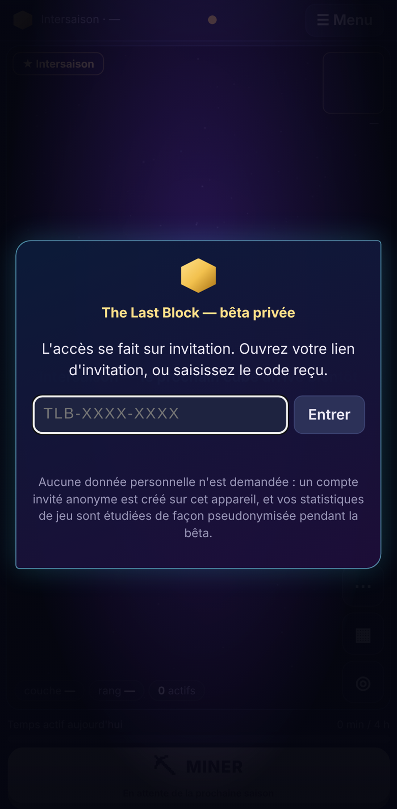
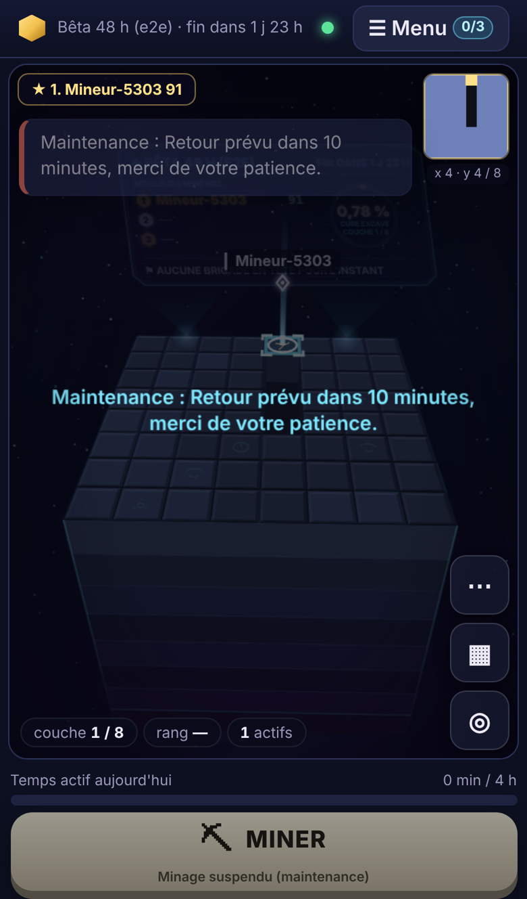
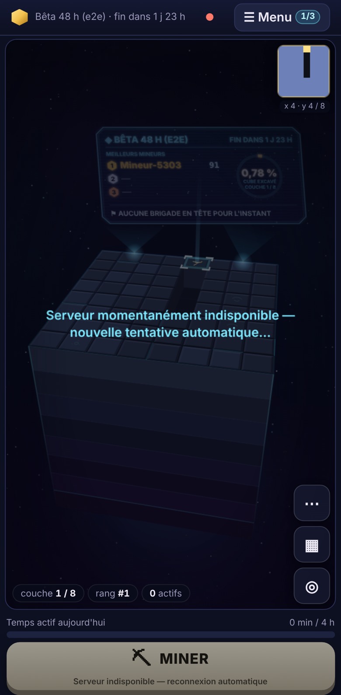

# Bêta privée de 48 h — guide d'exploitation

> **Statut : préparation technique et documentaire terminée. Rien n'est déployé ni hébergé, aucune dépense n'a été engagée.** Le lancement réel attend un accord explicite, comme le choix et le paiement éventuel d'un hébergement.

- **Cible** : 15 à 20 joueurs réels, en 3 ou 4 brigades de 5, pendant une saison unique de 48 h, avec le profil de découvertes `mini-48h`.
- **Règles** : identiques à la production. 5 coups par seconde, 4 h de minage actif par jour UTC, brigade championne à partir de 5 membres. Aucune connexion Google ou Apple n'est demandée.

Sommaire :

1. [Audit de préparation](#1-audit-de-préparation)
2. [Architecture de la bêta](#2-architecture-de-la-bêta)
3. [Prérequis](#3-prérequis)
4. [Configuration](#4-configuration)
5. [Installation et commandes exactes](#5-installation-et-commandes-exactes)
6. [Calibrage de la saison de 48 h](#6-calibrage-de-la-saison-de-48-h)
7. [Lancement](#7-lancement)
8. [Invitations](#8-invitations)
9. [Pendant la bêta : indicateurs à surveiller](#9-pendant-la-bêta--indicateurs-à-surveiller)
10. [Incidents, pause et fermeture d'urgence](#10-incidents-pause-et-fermeture-durgence)
11. [Sauvegardes et restauration](#11-sauvegardes-et-restauration)
12. [Fin de la bêta et arrêt](#12-fin-de-la-bêta-et-arrêt)
13. [Plan de retour arrière](#13-plan-de-retour-arrière)
14. [Données collectées et conservation](#14-données-collectées-et-conservation)
15. [Séparation des robots de test et des joueurs réels](#15-séparation-des-robots-de-test-et-des-joueurs-réels)
16. [Vérifications sur téléphone](#16-vérifications-sur-téléphone)
17. [Liste GO / NO-GO](#17-liste-go--no-go)
18. [Tests automatisés](#18-tests-automatisés)

---

## 1. Audit de préparation

L'audit a été fait sans exposer de serveur sur Internet. Tout a été vérifié localement, sur `127.0.0.1`. L'application Next.js indépendante du dépôt n'a pas été modifiée.

| Constat avant préparation | Risque pour une bêta privée | Correction apportée |
|---|---|---|
| N'importe qui peut créer un compte invité. | Des inconnus ou des robots entrent dans la bêta et faussent les mesures. | `ACCESS_MODE=invite` : un compte n'est créé qu'avec un code d'invitation **vérifié par le serveur**. Les codes sont stockés hachés et peuvent être à usage unique ou multiple, avec expiration et révocation. Les essais sont limités à 10 par 10 min et par IP. |
| `/api/stats`, le Hall, les saisons et les découvertes sont publics. | Le contenu de la bêta est lisible sans invitation. | En mode invitation, ces lectures exigent le jeton d'un joueur (en-tête `x-tlb-token`). `/api/stats` devient réservé à l'administration. |
| Aucune statistique de session, de retour ou de refus. | Impossible d'évaluer la bêta. | Ajout des sessions, des compteurs journaliers agrégés et de la présence à la clôture. Résumé côté administration et export CSV pseudonymisé, sans service tiers. |
| La sauvegarde repose sur `sqlite3 .backup`, à la main, et il n'existe aucune restauration outillée. | Risque de perte ou de restauration hasardeuse. | Sauvegarde à chaud vérifiée (`integrity_check`), par l'API ou par script. La restauration refuse de tourner si le serveur répond et conserve toujours l'ancienne base. |
| Il n'existe ni pause ni mode maintenance. | Un problème oblige à tout couper. | Une pause d'urgence persistée refuse les coups et affiche un message à tous les joueurs, y compris après rechargement ou redémarrage. |
| En cas d'indisponibilité, le client affiche seulement « Reconnexion… », puis « Connexion… » en alternance. | Les joueurs ne comprennent pas ce qui se passe. | Dès le 3ᵉ échec, le client affiche « Serveur indisponible » de façon stable, avec un message sur la scène et le bouton Miner désactivé. Les messages longs sont désormais renvoyés à la ligne sur téléphone ; ils étaient coupés avant. |
| Aucun garde-fou n'empêche de démarrer avec une configuration dangereuse. | Accès ouvert, secrets faibles ou base partagée par erreur. | `BETA_MODE=true` **refuse de démarrer** si un réglage est dangereux (voir § 4). |
| Le test de charge accepte n'importe quelle URL. | Des robots pourraient viser le serveur de la bêta. | Seules les cibles locales sont acceptées, sauf avec l'option explicite `--autoriser-distant`. |
| Seul Chromium est disponible ici. | Safari iOS n'est pas testable dans cet environnement. | Les émulations iPhone et Android tournent sous Chromium. Les tests restant à faire sur appareils physiques sont listés au § 16. |

**Inchangé** :

- comptes invités, jeton secret, rotation et révocation, 4 sessions par compte ;
- limites par IP ;
- 5 coups/s ;
- 4 h/jour ;
- seuil de 5 membres pour la brigade championne ;
- protocole (version 1, champs uniquement optionnels).

## 2. Architecture de la bêta

```
Téléphones et ordinateurs des invités
        │  HTTPS + WSS (certificat Let's Encrypt automatique)
        ▼
Caddy (port 443) ── /api/admin/* et /api/stats : 404 depuis Internet
        │  http://127.0.0.1:8080   (X-Forwarded-For ajouté)
        ▼
Node 22 : The Last Block (une seule instance, HOST=127.0.0.1)
        │
        ▼
SQLite dédiée : /var/lib/the-last-block/beta-48h.sqlite (+ sauvegardes horaires)

Administration : tunnel SSH → http://127.0.0.1:8080/api/admin/…  (ADMIN_TOKEN)
```

- **Le serveur de jeu n'écoute que localement.** Seul Caddy est joignable, en HTTPS.
- La page d'accueil reste techniquement accessible à qui connaît l'adresse, mais :
  - elle n'est pas indexée (`X-Robots-Tag: noindex`) ;
  - on ne peut y créer **aucun compte** sans invitation ;
  - aucune donnée de jeu n'y est lisible.
- **L'administration ne passe jamais par Internet.** Caddy répond 404 sur `/api/admin/*`, et on l'utilise par un tunnel SSH. Le jeton d'administration n'est jamais envoyé au client : un test vérifie qu'il est absent du code compilé, de la page, du stockage local et des messages WebSocket.

Fichiers d'exemple (non déployés) :

- [`.env.beta.example`](../.env.beta.example) ;
- [`docs/deploy/Caddyfile.beta`](deploy/Caddyfile.beta) ;
- [`docs/deploy/the-last-block-beta.service`](deploy/the-last-block-beta.service) ;
- [`docs/deploy/the-last-block-backup.service`](deploy/the-last-block-backup.service) et [`.timer`](deploy/the-last-block-backup.timer).

## 3. Prérequis

| Élément | Détail | Coût |
|---|---|---|
| Machine Linux joignable en HTTPS | 1 vCPU et 1 Go de RAM suffisent : le test de charge local tient 200 robots à 4,5 coups/s (voir [DEPLOYMENT.md](DEPLOYMENT.md#test-de-charge)). Cela peut être un petit VPS ou une machine personnelle avec redirection du port 443. | **À décider : aucun hébergement n'a été choisi ni payé.** |
| Nom de domaine ou sous-domaine | Il pointe vers la machine, par exemple `beta.exemple.fr`. | Un sous-domaine d'un domaine existant suffit. |
| Node.js 22 ou plus | `node:sqlite` est utilisé, sans dépendance native. | Gratuit |
| Caddy 2 | Fournit HTTPS et WSS, avec certificats automatiques. | Gratuit |
| Accès SSH | Pour l'administration et les sauvegardes. | — |
| `openssl` | Pour générer les secrets. | Gratuit |

Côté testeurs :

- un navigateur récent : Chrome Android, Safari iOS 16 ou plus, ou un navigateur de bureau ;
- aucune installation ni compte externe.

## 4. Configuration

1. Copier `.env.beta.example` vers `/etc/the-last-block/beta.env`, avec `chmod 600` et `chown lastblock`.
2. Générer **deux secrets distincts** :

   ```bash
   openssl rand -base64 48   # → ADMIN_TOKEN
   openssl rand -base64 48   # → STATS_PSEUDONYM_SECRET
   ```

3. Renseigner `ALLOWED_ORIGINS=https://<domaine-de-la-bêta>`. Ce domaine doit être le même que dans le Caddyfile.
4. Ne pas toucher aux limites. `BETA_MODE=true` refuse de démarrer, et affiche la liste des erreurs, si :

   | Refus au démarrage | Pourquoi |
   |---|---|
   | `ACCESS_MODE` ≠ `invite` | Accès privé obligatoire. |
   | `ADMIN_TOKEN` ou `STATS_PSEUDONYM_SECRET` de moins de 32 caractères, ou identiques | Secrets faibles ou réutilisés. |
   | `DB_PATH` par défaut ou `:memory:` | Base dédiée obligatoire, jamais partagée avec un autre environnement. |
   | `ALLOWED_ORIGINS` vide ou non `https://` | Le WebSocket n'est accepté que depuis la page de la bêta, en WSS. |
   | `MAX_ACTIONS_PER_SECOND` ≠ 5, `DAILY_ACTIVE_LIMIT_MINUTES` ≠ 240 ou `BRIGADE_MIN_SIZE` < 5 | Mêmes règles qu'en production. |
   | `DISCOVERY_PROFILE` ≠ `mini-48h` | Profil prévu pour la saison courte. |

   Des avertissements, sans refus, sont affichés si :
   - `SEASON_DURATION_HOURS` ≠ 48 ;
   - `AUTO_START_SEASON=true` ;
   - `HOST` n'est pas local ;
   - `TRUST_PROXY=false`.

## 5. Installation et commandes exactes

À exécuter sur la machine de la bêta, **après accord**.

```bash
# Utilisateur et dossiers
sudo useradd --system --home /opt/the-last-block --shell /usr/sbin/nologin lastblock
sudo mkdir -p /opt/the-last-block /var/lib/the-last-block/backups /etc/the-last-block
sudo chown -R lastblock: /var/lib/the-last-block

# Code : version figée par une étiquette git (permet le retour arrière, § 13)
git clone <dépôt> /tmp/tlb && cd /tmp/tlb && git checkout <étiquette-beta>
sudo cp -r the-last-block/. /opt/the-last-block/
cd /opt/the-last-block
sudo -u lastblock npm ci
sudo -u lastblock npm run build
sudo -u lastblock npm test            # 239 tests attendus, tous verts

# Configuration (voir § 4)
sudo cp .env.beta.example /etc/the-last-block/beta.env
sudo chmod 600 /etc/the-last-block/beta.env && sudo chown lastblock: /etc/the-last-block/beta.env
sudoedit /etc/the-last-block/beta.env

# Services
sudo cp docs/deploy/the-last-block-beta.service docs/deploy/the-last-block-backup.{service,timer} /etc/systemd/system/
sudo systemctl daemon-reload
sudo systemctl enable --now the-last-block-beta the-last-block-backup.timer
journalctl -u the-last-block-beta -n 20     # « MODE BÊTA PRIVÉE », « serveur prêt », aucun avertissement

# HTTPS
sudo cp docs/deploy/Caddyfile.beta /etc/caddy/Caddyfile   # remplacer beta.exemple.fr
sudo systemctl reload caddy
```

Contrôles rapides :

```bash
curl -s http://127.0.0.1:8080/api/health          # {"ok":true,"db":"ok",…}
curl -s https://beta.exemple.fr/api/health         # même réponse, via HTTPS
curl -s -o /dev/null -w '%{http_code}\n' https://beta.exemple.fr/api/hall        # 401 (invitation requise)
curl -s -o /dev/null -w '%{http_code}\n' https://beta.exemple.fr/api/admin/status # 404 (fermé par Caddy)
```

L'administration se fait depuis son poste, par un tunnel :

```bash
ssh -N -L 8080:127.0.0.1:8080 utilisateur@serveur &
export TLB=http://127.0.0.1:8080 ADMIN_TOKEN='…'     # ne jamais l'écrire dans un fichier partagé
alias tlb='curl -s -H "Authorization: Bearer $ADMIN_TOKEN" -H "content-type: application/json"'
tlb $TLB/api/admin/status | jq
```

## 6. Calibrage de la saison de 48 h

```bash
npm run calibrate -- --beta                    # trois préréglages, matrice de scénarios
npm run calibrate -- --beta --size 16          # même chose avec un cube de 16
npm run calibrate -- --beta --size 12 --base 35 --per 7    # évaluer des paramètres précis
```

**Hypothèses d'activité**, par joueur invité, moyennées sur 48 h :

| Scénario | Invités qui jouent un jour donné | Minutes de minage actif par jour | Coups/s pendant le minage |
|---|---|---|---|
| Faible | 50 % | 20 | 2 |
| Moyenne | 70 % | 45 | 3 |
| Forte | 90 % | 90 | 3,5 |

Les écarts sont considérables : l'activité forte produit environ **14 fois** plus de coups que l'activité faible. **Aucun cube ne peut finir « à l'heure » dans tous les cas.** Il faut choisir avant le lancement.

### Préréglage CENTRAL (recommandé) : `CUBE_SIZE=12 BLOCK_BASE_HP=35 BLOCK_HP_PER_LAYER=7`

Le cube compte 1 728 blocs. Il faut 35 coups par bloc en surface et 112 au fond, soit **127 008 coups** au total. Un joueur seul met de 8 à 25 s par bloc.

| Invités | Scénario | Coups par heure | Fin du cube | Avancement à 48 h | Risque |
|---|---|---|---|---|---|
| 15 | faible | 750 | — | 28 % | **non terminé** |
| 15 | moyenne | 3 544 | 35,8 h | 100 % | dans la fenêtre |
| 15 | forte | 10 631 | 11,9 h | 100 % | **trop tôt** |
| 20 | faible | 1 000 | — | 38 % | **non terminé** |
| 20 | moyenne | 4 725 | 26,9 h | 100 % | dans la fenêtre |
| 20 | forte | 14 175 | 9 h | 100 % | **trop tôt** |

Borne haute théorique : 20 joueurs × 4 h par jour UTC × 5 coups/s. Une saison de 48 h qui ne commence pas à minuit UTC touche 3 jours UTC, soit 12 h de jeu possibles par joueur. Dans ce cas, le cube serait fini en 1,4 h.

### Autres préréglages (même cube de 12)

| Préréglage | Paramètres | Total de coups | Termine à temps si… | Sinon |
|---|---|---|---|---|
| PRUDENT | base 10, +1 par couche | 26 784 | activité faible (fin vers 27 à 36 h) | activité moyenne ou forte : fini en 2 à 8 h |
| SOUTENU | base 147, +27 par couche | 510 624 | 20 invités en activité forte (36 h) | sinon : 7 à 44 % du cube à l'échéance |

Avec un cube de 16 (4 096 blocs, plus petits à l'écran), les durées sont équivalentes. Le cube de 12 reste plus lisible sur téléphone.

### Risques et conséquences, à accepter avant le lancement

**Fin trop tôt**, par exemple le premier soir :

- la saison se clôt normalement : Pierre finale, cérémonie, archive ;
- avec `AUTO_START_SEASON=false`, rien ne redémarre et le reste des 48 h se passe en intersaison ;
- les mesures du second jour (retour à 24 h) restent possibles, mais sans minage.

Option à décider **à l'avance** : lancer une **seconde saison distincte** avec un cube plus dur. Elle a son propre classement, et la première n'est pas modifiée.

**Pas de fin à 48 h** :

- clôture par échéance : la cérémonie et le champion (contribution) sont attribués normalement ;
- **la Pierre finale n'est pas attribuée** ;
- le dernier fragment du Signal (« transmission finale », à la dernière couche) n'est pas révélé ;
- seuls les fragments des couches atteintes le sont : couches 3, 6, 9 et 12 pour un cube de 12.

**Ce qui n'est jamais fait** : modifier les scores, les classements, la résistance des blocs ou la durée d'une saison en cours. Le moteur ne le permet d'ailleurs pas : une saison en cours n'est pas recalibrée.

**Recommandation** :

1. Interroger les invités avant la bêta sur leur disponibilité (§ 7, première question du questionnaire préalable).
2. Garder le préréglage CENTRAL si la majorité prévoit d'y consacrer de 30 à 60 min par jour ; passer au PRUDENT si c'est moins de 20 min.
3. Suivre `GET /api/season/projection` (§ 9).

## 7. Lancement

### J-3 à J-1

1. Envoyer aux invités un message court : principe, dates, durée, aucune donnée personnelle, lien du questionnaire. Leur demander :
   - le temps de jeu prévu par jour ;
   - l'appareil utilisé (Android ou iPhone).
2. Choisir le préréglage (§ 6) et l'heure de début.
   - Conseil : un **vendredi à 18 h, heure de Paris (17 h UTC)**, pour finir le dimanche à 18 h, à une heure où beaucoup de joueurs sont présents pour la cérémonie.
   - Rappel : la limite de 4 h et les missions sont remises à zéro à **minuit UTC**, soit 1 h du matin à Paris en hiver.
3. Constituer **3 ou 4 brigades de 5 ou 6 joueurs**. Le seuil de 5 membres s'apprécie **à la clôture** : avec 6 membres, un départ ne disqualifie pas la brigade. Une brigade de 4 ne peut pas être championne.
4. Dérouler la liste GO / NO-GO (§ 17), y compris un **essai de restauration** (§ 11).

### H0 : démarrer la saison

```bash
tlb -X POST $TLB/api/admin/season/start -d '{"name":"Bêta 48 h","durationHours":48,"cubeSize":12,"baseHp":35,"hpPerLayer":7,"discoveryProfile":"mini-48h"}' | jq '.season, .discoveries.fragments | length'
tlb -X POST $TLB/api/admin/backup -d '{}' | jq .backup      # sauvegarde H0
```

Ensuite, envoyer les liens d'invitation (§ 8) et vérifier la création des comptes dans `/api/admin/beta/summary`.

## 8. Invitations

```bash
# Un lien par joueur, étiqueté par brigade (l'étiquette sert aux statistiques, jamais au jeu)
tlb -X POST $TLB/api/admin/invites -d '{"count":5,"label":"Brigade A","expiresInHours":72}' | jq -r '.invites[].code'
# Une invitation de groupe (6 utilisations) si l'on préfère un seul lien par brigade
tlb -X POST $TLB/api/admin/invites -d '{"count":1,"label":"Brigade B","maxUses":6,"expiresInHours":72}'
# Comptes de test de l'équipe (exclus des statistiques)
tlb -X POST $TLB/api/admin/invites -d '{"count":2,"label":"Équipe","kind":"test"}'
# Suivi et révocation (un code diffusé par erreur)
tlb $TLB/api/admin/invites | jq '.invites[] | {id,label,uses,maxUses,revoked,expiresAt}'
tlb -X POST $TLB/api/admin/invites/inv_0123456789ab/revoke -d '{}'
```

- **Codes** : de la forme `TLB-XXXX-XXXX`, sans caractère ambigu (0/O, 1/I/L). Ils ne sont **affichés qu'une seule fois**, à la création ; le serveur n'en garde que l'empreinte. La saisie tolère les minuscules et les espaces.
- **Lien à envoyer** : `https://beta.exemple.fr/?invitation=TLB-XXXX-XXXX`. Le code est retiré de la barre d'adresse dès l'ouverture, puis oublié par l'appareil une fois le compte créé.
- **Un code par personne** : c'est préférable, car le compte est lié à l'appareil (compte invité). Un joueur qui change de téléphone a besoin d'un nouveau code. Il n'existe pas de transfert de compte : c'est une limite connue.
- Les comptes déjà créés **reprennent sans invitation** : le jeton de l'appareil suffit, et les codes expirés ou révoqués ne les affectent pas.

## 9. Pendant la bêta : indicateurs à surveiller

```bash
tlb $TLB/api/admin/status | jq '{db, pause, seasonStartError, lastBackup, season: .season.name, projection, connected: .stats.connections}'
tlb $TLB/api/admin/beta/summary | jq '{participants, activePlayersByDay, sessions, retention, hitsCounters, season}'
```

| Indicateur | Où le lire | Normal | Agir si… |
|---|---|---|---|
| Santé, base | `/api/health`, `status.db` | `ok` | `error`, ou 503 → § 10 |
| Projection de fin | `status.projection` (`projectedCompletionAt`, `avgHitsPerHour`, `recentHitsPerHour`, `completesBeforeEnd`) | fin entre H+24 et H+46 | fin avant H+12 ou après H+60 : prévenir les joueurs. **Ne pas** recalibrer : voir les options du § 6. |
| Participants inscrits | `summary.participants.registered` | il monte à 15-20 dans les 12 premières heures | moins de 10 à H+6 : relancer les invités |
| Actifs par jour | `summary.activePlayersByDay` | — | — |
| Sessions, durée médiane | `summary.sessions` | quelques minutes à des dizaines | sessions de moins de 1 min en masse : souci de connexion probable |
| Coups refusés | `summary.hitsCounters.refusedByReason` | `rate_limited` faible (gigue réseau) | `rate_limited` supérieur à 5 % des coups acceptés, ou `invalid_*` inattendus : regarder les journaux |
| Échecs d'invitation | compteurs `invite:*` (export `daily`) | quelques-uns | dizaines : tentative de devinette ou lien mal copié |
| Brigades | `summary.season.brigades` (`qualified` = 5 membres ou plus) | 3-4 brigades qualifiées | une brigade à 4 : prévenir que le seuil se juge à la clôture |
| Sauvegarde | `status.lastBackup` | moins d'une heure | plus d'une heure : vérifier le minuteur |
| Mémoire, connexions | `status.stats` | stable | croissance continue : redémarrage planifié (§ 10) |
| Erreurs serveur | `journalctl -u the-last-block-beta -p warning` | aucune | toute trace `[ws]`, `[http]` ou `[tick]` |

Les compteurs journaliers sont écrits en base toutes les 30 s et à l'arrêt. Le résumé a donc jusqu'à 30 s de retard.

## 10. Incidents, pause et fermeture d'urgence

### Pause d'urgence

Elle suspend le minage pour tous ; tout le reste reste consultable.

```bash
tlb -X POST $TLB/api/admin/pause -d '{"message":"Retour prévu vers 21 h, merci de votre patience."}'
tlb -X POST $TLB/api/admin/pause -d '{"message":null}'    # lever la pause
```

- Les joueurs voient « Maintenance : … » sur la scène et dans une notification. Le bouton Miner est désactivé avec la mention « Minage suspendu (maintenance) ».
- La pause survit à un redémarrage.
- **L'horloge de la saison continue** : une pause longue raccourcit d'autant le temps de jeu, et les durées restent celles annoncées.
- Le message fait 160 caractères au plus, sans `<`, `>` ni caractère de contrôle. Ne pas commencer par « Maintenance », c'est déjà affiché.

### Redémarrage après incident

| Situation | Action | Ce que voient les joueurs |
|---|---|---|
| Processus arrêté ou planté | systemd relance en 3 s (`Restart=on-failure`). Aucun coup validé n'est perdu (vérifié par SIGKILL réel dans `tests/crash.test.ts`). | « Reconnexion… », puis reprise automatique avec le même compte et les mêmes coups. Vérifié en e2e. |
| Arrêt de plus de quelques secondes | `sudo systemctl restart the-last-block-beta`, puis `curl …/api/health`. | Dès le 3ᵉ échec : « Serveur indisponible », message « Serveur momentanément indisponible — nouvelle tentative automatique… », bouton Miner désactivé. Les tentatives s'espacent jusqu'à 30 s. |
| Base corrompue (`db: error`, 503) | Pause impossible : arrêter le service, restaurer la dernière sauvegarde (§ 11), redémarrer. | Indisponible pendant l'opération. Les coups faits depuis la sauvegarde sont perdus et le classement revient à l'état sauvegardé. **Prévenir les joueurs.** |
| `ADMIN_TOKEN` compromis | Générer un nouveau jeton, mettre à jour `beta.env`, redémarrer. L'ancien cesse immédiatement d'être valide. | Une brève reconnexion. |
| Code d'invitation diffusé publiquement | Le révoquer (§ 8). Les comptes déjà créés avec ce code restent valides. | Rien |

### Fermeture d'urgence, par ordre de gravité croissante

1. **Pause** (ci-dessus) : réversible et immédiate.
2. **Fermer les inscriptions** : révoquer toutes les invitations non utilisées. Réversible, en recréant des codes.
3. **Couper l'accès public** : dans le Caddyfile, remplacer `reverse_proxy …` par `respond "La bêta de The Last Block est suspendue. Merci de votre participation." 503`, puis `systemctl reload caddy`. Le jeu tourne toujours en local ; c'est réversible.
4. **Arrêter le service** : `sudo systemctl stop the-last-block-beta`. Faire d'abord une sauvegarde (§ 11) ; c'est réversible.
5. **Clore la saison par anticipation** : `tlb -X POST $TLB/api/admin/season/end -d '{}'`. La cérémonie a lieu avec le motif « clôture administrative » et l'archive est figée. **Irréversible.**

## 11. Sauvegardes et restauration

**Automatique** : le minuteur systemd fait une sauvegarde toutes les heures, conservée 14 jours.

À la main, serveur en marche :

```bash
tlb -X POST $TLB/api/admin/backup -d '{}' | jq .backup
#  → {"file":"lastblock-20261120T170000Z.sqlite","bytes":…,"check":{"ok":true,"integrity":"ok","players":…,"hits":…}}
# ou, sur le serveur :
sudo -u lastblock env DB_PATH=/var/lib/the-last-block/beta-48h.sqlite BACKUP_DIR=/var/lib/the-last-block/backups npm run backup
```

- La copie est faite par `VACUUM INTO`. Elle est cohérente même pendant le minage.
- La copie est ensuite **vérifiée** : `integrity_check` puis comptages.
- Un fichier existant n'est jamais écrasé.

**Restauration** (serveur **arrêté**) :

```bash
sudo systemctl stop the-last-block-beta
sudo -u lastblock node scripts/restore.mjs --backup /var/lib/the-last-block/backups/lastblock-….sqlite \
     --db /var/lib/the-last-block/beta-48h.sqlite --port 8080
sudo systemctl start the-last-block-beta && curl -s http://127.0.0.1:8080/api/health
```

- Le script refuse de tourner si le serveur répond encore sur `/api/health`.
- Il vérifie la sauvegarde avant de toucher à quoi que ce soit.
- La base en place, avec ses fichiers `-wal` et `-shm`, est **renommée** en `….avant-restauration-<date>` ; elle n'est jamais supprimée.

**Essai obligatoire avant le lancement** : restaurer une sauvegarde sur une copie, par exemple `--db /tmp/essai.sqlite`, et lancer le serveur dessus avec un autre `PORT`.

## 12. Fin de la bêta et arrêt

1. **H+48** :
   - la saison se clôt seule (échéance) ou plus tôt (Pierre finale) ;
   - la cérémonie de 41 s est jouée sur tous les écrans connectés ;
   - le nombre de joueurs présents est enregistré, ainsi que ceux actifs dans les 5 dernières minutes.
2. Faire une sauvegarde finale (§ 11).
3. Exporter les statistiques (CSV pseudonymisés), puis les copier hors du serveur :

   ```bash
   for t in players sessions daily cube brigades; do tlb "$TLB/api/admin/beta/export?table=$t" > beta-$t.csv; done
   tlb $TLB/api/admin/beta/summary > beta-resume.json
   ```

4. Révoquer les invitations restantes, puis **mettre la bêta hors ligne** :
   - page « bêta terminée » dans Caddy (§ 10, point 3) ;
   - `systemctl disable --now the-last-block-beta the-last-block-backup.timer`.
5. Envoyer le questionnaire de retour ([BETA-QUESTIONNAIRE.md](BETA-QUESTIONNAIRE.md)) dans les 24 h.
6. Appliquer la conservation des données (§ 14).

## 13. Plan de retour arrière

| Problème | Retour arrière |
|---|---|
| Défaut bloquant dans la version déployée | `git checkout <étiquette-précédente>`, puis `npm ci && npm run build` et `systemctl restart`. Le schéma de base est migré de façon additive (colonnes et tables ajoutées), donc une version antérieure devrait ouvrir la base. **Ce n'est pas testé** : en cas de doute, restaurer la sauvegarde H0 faite avec la version précédente. |
| Corruption ou fausse manœuvre sur la base | Restauration de la dernière sauvegarde saine (§ 11). L'ancienne base est conservée à côté. |
| Mauvaise configuration | `BETA_MODE` refuse le démarrage et liste les erreurs. Remettre la copie précédente de `beta.env` (garder une copie datée à chaque modification). |
| Comportement inacceptable en cours de bêta | Pause (§ 10). Puis, selon la décision prise : correction et redémarrage, ou fermeture d'urgence. |
| Abandon complet | Page « bêta suspendue » dans Caddy, arrêt des services, sauvegarde finale, puis conservation et suppression des données (§ 14). |

## 14. Données collectées et conservation

**Aucun service tiers d'analytics** : aucun script externe, ni cookie, ni traceur. La politique de sécurité du contenu (CSP) interdit d'ailleurs les scripts externes. Tout reste dans la base SQLite de la bêta.

| Donnée | Contenu | Finalité |
|---|---|---|
| Compte invité | Identifiant aléatoire, pseudo (généré, par exemple « Mineur-4295 », ou choisi), empreinte du jeton, apparence, date de création, dernier coup, invitation utilisée, marque « test » | Faire fonctionner le jeu ; mesurer les inscriptions par groupe |
| Invitations | Empreinte du code, étiquette (par exemple « Brigade A »), utilisations, dates | Contrôler l'accès |
| Coups | Joueur, bloc, couche, horodatage, identifiant d'action | Jeu (classement, idempotence) et progression du cube |
| Temps actif | Minutes actives par joueur et par jour UTC | Limite de 4 h ; joueurs actifs par jour |
| Sessions | Début et fin de chaque connexion, par joueur. **Ni IP ni navigateur.** | Durée de session, retour sous 24 h |
| Compteurs journaliers | Totaux par jour : coups acceptés, doublons, refus par motif, échecs d'invitation. **Agrégés, sans joueur.** | Qualité technique |
| Présence à la clôture | Nombre de joueurs connectés et actifs à la fin de la saison | Mesure de la cérémonie |
| Missions, brigades, découvertes, archive de saison | Comme en jeu normal | Jeu |

**Non collecté** : adresse IP (utilisée uniquement en mémoire pour les limites anti-abus, jamais écrite), e-mail, nom réel, numéro de téléphone, position, empreinte de l'appareil, contenu du presse-papiers. Le serveur n'écrit ni IP ni jeton dans ses journaux.

**Export pseudonymisé** (`/api/admin/beta/export`) :

- Les identifiants sont remplacés par `J-xxxxxxxxxx` (joueurs) et `B-xxxxxxxxxx` (brigades). Ces valeurs sont calculées par HMAC-SHA256 avec `STATS_PSEUDONYM_SECRET` ; elles sont stables pendant la bêta, ce qui permet de croiser les tables.
- **Aucun pseudo, nom de brigade, jeton ni code** ne figure dans l'export. C'est testé.
- Les cellules commençant par `=`, `+`, `-` ou `@` sont neutralisées contre l'injection de formules dans les tableurs.
- Les comptes de test sont exclus.

**Conservation proposée** (à valider) :

| Élément | Durée | Ensuite |
|---|---|---|
| Base de la bêta et sauvegardes | **30 jours** après la fin de la bêta : analyse, éventuelles réclamations | Suppression : `shred` ou suppression du volume |
| `STATS_PSEUDONYM_SECRET` | Détruit en même temps que la base | Les CSV deviennent **anonymes** : plus aucun lien possible avec un compte |
| Exports CSV et résumé JSON | 12 mois, pour comparer avec une bêta suivante | Suppression |
| Réponses au questionnaire | 12 mois, sans lien avec le compte de jeu sauf si le joueur indique volontairement son pseudo | Suppression |

À communiquer aux testeurs, ce que fait le texte de l'écran d'invitation : pas de donnée personnelle demandée, compte anonyme sur l'appareil, statistiques étudiées sous pseudonyme.

## 15. Séparation des robots de test et des joueurs réels

- **Par construction**, un robot ne peut pas entrer dans la bêta sans invitation : il est refusé avec le code 4004 et aucun compte n'est créé.
  - `npm run loadtest` refuse toute cible non locale, sauf `--autoriser-distant`, réservé à un serveur de test dédié.
  - Les tests e2e démarrent leurs propres serveurs, chacun sur une base temporaire.
- Les comptes de l'équipe passent par des invitations `"kind":"test"`. Ils sont marqués `is_test` et **exclus de toutes les statistiques** : inscrits, actifs, sessions, rétention, exports. Ils restent visibles en jeu, au classement compris.
  - Conseil : ne pas faire miner les comptes de test pendant la bêta, pour ne pas peser sur le classement des joueurs.
- La base de la bêta est dédiée. `BETA_MODE` refuse la base par défaut, et aucun test automatisé ne l'utilise.

## 16. Vérifications sur téléphone

Seul Chromium est installé dans cet environnement. « Émulé » signifie : moteur Chromium, avec l'écran, le ratio de pixels, le tactile et l'agent utilisateur du modèle.

| Vérification | Android Chrome (Pixel 7 émulé) | iPhone (iPhone 13 émulé, **Chromium**) | Sur appareil physique |
|---|---|---|---|
| Écran d'invitation, saisie au doigt, code faux puis bon | ✔ e2e-beta | — | Clavier réel, majuscules auto : **à faire** |
| Lien `?invitation=` puis retrait de l'adresse | ✔ | ✔ e2e-beta | Ouverture depuis SMS, WhatsApp ou e-mail (navigateurs intégrés) : **à faire** |
| Champ du code ≥ 16 px (pas de zoom automatique iOS) | ✔ (16 px mesurés) | ✔ | Comportement réel de Safari : **à faire** |
| Toucher, glisser, pincer pour zoomer | — | ✔ e2e-browser (gestes CDP réels) | Safari : gestes système, double tap, rebond : **à faire** |
| Minage continu (bouton maintenu) | ✔ 20 s, environ 91 coups, mémoire JS +0,5 Mo | ✔ e2e-missions (coups au doigt) | Appui long : menu contextuel iOS, vibration : **à faire** |
| Coupure et reconnexion | ✔ arrêt et redémarrage du serveur, même compte, coups conservés | ✔ rechargement | Changement Wi-Fi/4G, mise en veille, retour d'arrière-plan : **à faire** |
| Découvertes (Signal) | ✔ e2e-decouvertes | ✔ | — |
| Missions et brigades | ✔ e2e-missions, e2e-brigades | ✔ | — |
| Cérémonie | ✔ e2e-ceremonie | ✔ | Son et vibration (aucun), lecture dans la luminosité réelle : **à faire** |
| Pause et indisponibilité : messages lisibles | ✔ | ✔ | — |
| Performance et mémoire | Mémoire JS stable en minage continu ; images par seconde mesurées par e2e-browser et e2e-ceremonie (CPU ralenti ×4) | idem | Téléphone d'entrée de gamme : chauffe, batterie sur 30 min : **à faire** |
| WSS derrière HTTPS (Caddy) | Non testé ici (aucun certificat) | Non testé | **À faire sur le serveur de la bêta**, avant GO |

**Avant GO**, faire une session de 15 min sur au moins un vrai iPhone (Safari) et un vrai Android (Chrome), par le domaine HTTPS réel :

1. Ouvrir le lien d'invitation.
2. Miner en continu pendant 2 min.
3. Passer en 4G puis revenir.
4. Verrouiller l'écran 1 min.
5. Rouvrir l'onglet.
6. Ouvrir Missions, Brigade et Archives.
7. Activer une pause depuis l'administration et vérifier le message.

## 17. Liste GO / NO-GO

Tout doit être coché pour **GO**. Une seule case non cochée vaut **NO-GO**.

**Accord et cadrage**

- [ ] Accord explicite pour le lancement réel, l'hébergement choisi et son coût éventuel.
- [ ] Dates, heure de début et préréglage de cube validés, avec les risques du § 6 acceptés.
- [ ] Message d'invitation et questionnaire prêts.

**Technique**

- [ ] `npm test` : 239 tests verts sur la version étiquetée.
- [ ] Les e2e passent sur les deux rendus : `e2e`, `e2e:decouvertes`, `e2e:missions`, `e2e:brigades`, `e2e:ceremonie`, `e2e:beta`.
- [ ] `journalctl` affiche « MODE BÊTA PRIVÉE », sans aucun avertissement de configuration.
- [ ] `https://…/api/health` répond `ok`, et `https://…/api/admin/status` répond **404**.
- [ ] `https://…/api/hall` répond **401** sans jeton.
- [ ] Le WebSocket est refusé depuis une autre origine, par exemple avec `websocat` et un en-tête `Origin` différent.
- [ ] Les secrets sont uniques, en `chmod 600`, et ne figurent ni dans le dépôt ni dans une conversation.

**Exploitation**

- [ ] Le minuteur de sauvegarde est actif, et une sauvegarde a moins d'une heure.
- [ ] Un **essai de restauration** a été réussi sur une copie.
- [ ] La pause a été activée puis levée sur le serveur réel, et le message vu sur un téléphone.
- [ ] Un redémarrage du service a été fait : le client se reconnecte seul.
- [ ] Le tunnel SSH d'administration a été testé par la personne d'astreinte.
- [ ] Une personne d'astreinte est joignable pendant les 48 h, avec le § 10 sous la main.

**Joueurs**

- [ ] Les invitations sont créées, étiquetées par brigade et envoyées. Un code de réserve est prévu par brigade.
- [ ] Les brigades comptent 5 à 6 membres et le seuil de 5 à la clôture a été expliqué.
- [ ] Les testeurs ont été prévenus des points suivants : l'heure UTC de remise à zéro, la limite de 4 h, le compte lié à l'appareil, et le fait que la fin peut être anticipée ou que le cube peut rester inachevé.
- [ ] Le test sur appareils physiques (§ 16) a été fait par le domaine réel.

## 18. Tests automatisés

```bash
npm test                                         # 239 tests Vitest (19 fichiers)
npm run typecheck && npm run build
NODE_PATH=$(npm root -g) npm run e2e:beta -- --rendu monolithe    # 29 vérifications (aussi --rendu classique)
```

**`tests/beta.test.ts`** (16 tests) :

- **Configuration** : refus au démarrage et avertissements.
- **Invitations** :
  - format et normalisation ;
  - refus sans code, avec un code faux, épuisé, révoqué ou expiré ;
  - stockage de l'empreinte seule ;
  - comptes de test exclus ;
  - reprise par jeton.
- **Pause** : refus des coups, doublons inchangés, persistance au redémarrage, levée.
- **Statistiques** : actifs par jour, sessions, retour le lendemain et sous 24 h, refus par motif.
- **Export CSV** : sans pseudo, identifiant, jeton ni code ; pseudonymes stables ; neutralisation des formules.
- **Sauvegarde et restauration** :
  - sauvegarde à chaud cohérente ;
  - refus d'écraser une sauvegarde existante ;
  - ancienne base conservée ;
  - sauvegarde abîmée refusée.
- **Bout en bout WebSocket et HTTP** :
  - fermeture 4004 ;
  - limite de 10 essais par IP ;
  - API protégées ;
  - routes d'administration ;
  - pause diffusée ;
  - sauvegarde ;
  - présence à la clôture ;
  - aucun secret transmis au client.

**`tests/calibration.test.ts`** (3 tests ajoutés) :

- chaque préréglage termine dans la fenêtre pour son propre scénario ;
- un préréglage central ne couvre pas les extrêmes, ce qui documente les deux risques ;
- seuils de risque et borne haute.

**`scripts/e2e-beta.mjs`** (29 vérifications par rendu) :

- refus et acceptation du `BETA_MODE` au démarrage du vrai serveur ;
- écran d'invitation sur Android ;
- lien d'invitation sur iPhone ;
- robot de test exclu ;
- minage continu avec mesure de la mémoire ;
- pause visible et persistante ;
- arrêt et redémarrage du serveur avec message d'indisponibilité ;
- statistiques et export ;
- API protégées ;
- sauvegarde à chaud ;
- absence de secret dans le client.

Captures : `beta-invitation-android-*.png`, `beta-maintenance-iphone-*.png`, `beta-indisponible-android-*.png`, dans le dossier `--out`. Celles de la dernière exécution sont dans [docs/captures/beta](captures/beta/) :

| Écran d'invitation (Android) | Maintenance (iPhone) | Serveur indisponible (Android) |
|---|---|---|
|  |  |  |
