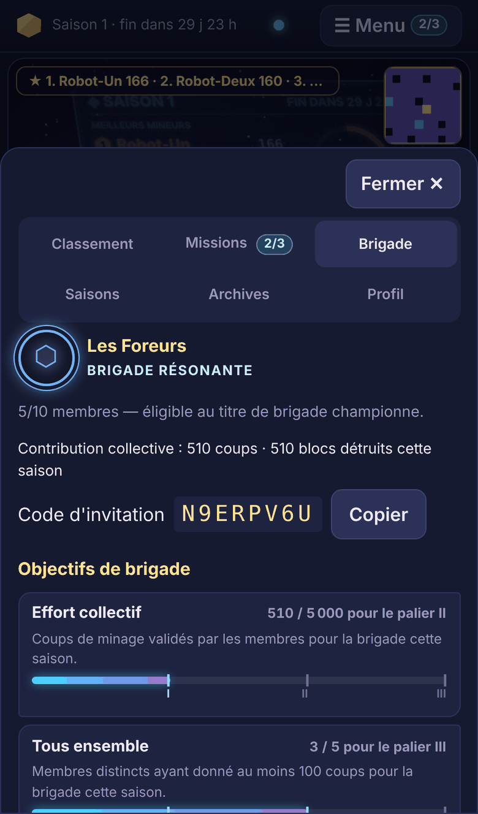
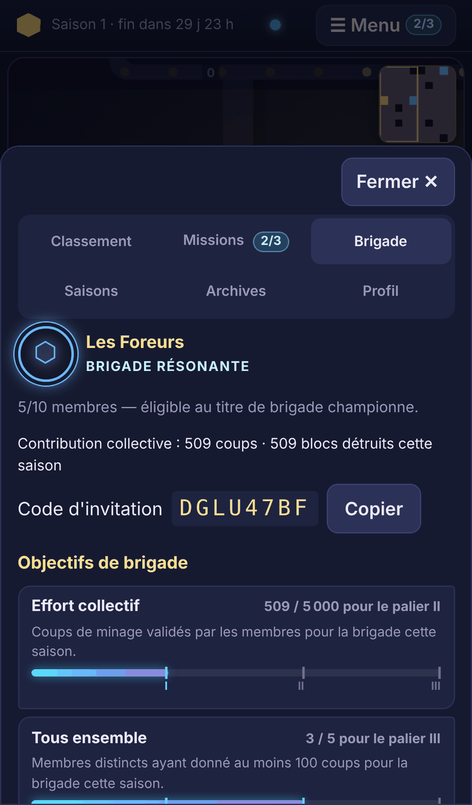
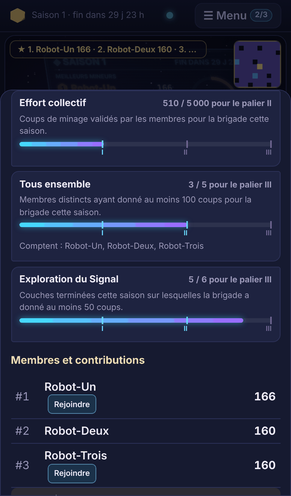
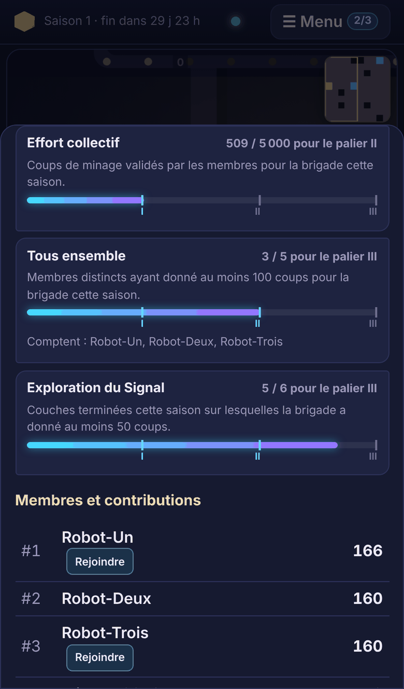

# Objectifs de brigade

Les brigades ont désormais un but collectif propre : trois objectifs de saison à paliers, des distinctions et une identité visuelle. Le championnat individuel et le titre de brigade championne ne changent pas. La cérémonie de fin de saison et la mini-saison ne sont **pas** commencées.

Ce document couvre aussi la modification demandée sur la teinte « Signal » (fin du document).

## Audit de l'existant (avant développement)

| Élément | Constat | Conséquence pour les objectifs |
|---|---|---|
| Taille | De 1 à 10 membres (`BRIGADE_MAX_SIZE`). Éligibilité au titre à partir de 5 membres, vérifiée à la clôture. | Inchangé. Les objectifs ne testent jamais l'éligibilité : une brigade de 2 progresse. |
| Attribution des coups | `hits.brigade_id` retient la brigade **au moment du coup** ; `brigade_contributions` cumule par saison et par brigade. | Règle réutilisée telle quelle : une contribution appartient à la brigade du moment. « Effort collectif » lit directement ce compteur. |
| Contribution par membre | Absente. La liste des membres affichait le score **total** de chaque joueur, pas sa contribution à la brigade. | Nouvelle table `brigade_member_contributions`, alimentée dans la transaction du coup. |
| Départ | Un membre retiré n'efface rien ; une brigade vide est **supprimée** et son nom redevient libre. | Les contributions passées restent acquises. Une brigade recréée sous le même nom est une **nouvelle** brigade (nouvel identifiant). |
| Diffusion | L'état d'une brigade n'était envoyé qu'aux arrivées et aux départs, donc vite périmé. | Envoi groupé aux membres connectés quand la progression change ; envoi immédiat pour une distinction. |
| Rejoindre un membre | La fonction ⚑ amène la caméra au membre vu en train de miner (présence réelle, 20 s). | Réutilisée avec une cible : un bouton « Rejoindre » par membre actif. |
| Couleur | Palette de dix couleurs dérivées du nom (côté client). | Réutilisée pour l'emblème. |

## Les objectifs (saisonniers, à paliers)

| Objectif | Mesure | Paliers I / II / III (configurables) |
|---|---|---|
| Effort collectif | coups validés par les membres **pour la brigade** cette saison | 500 / 5 000 / 25 000 |
| Tous ensemble | membres distincts ayant donné au moins **100 coups** pour la brigade | 2 / 3 / 5 membres |
| Exploration du Signal | couches **terminées** sur lesquelles la brigade a donné au moins **50 coups** | 1 / 3 / 6 couches |

- **Configuration** : seuils, minimums, libellés des paliers et titres se trouvent dans `server/content/brigade-objectives.json`, validé au démarrage. Les paliers doivent être croissants, et « Tous ensemble » ne peut pas exiger plus de 10 membres.
- **Petits groupes** : les premiers paliers des trois objectifs sont accessibles à une brigade de **2** membres. C'est testé, sur une brigade non éligible au titre.
- **Pourquoi des paliers de saison, et pas d'objectifs quotidiens** : une progression qui ne fait que croître pendant la saison ne peut pas être « remise à zéro » pour regagner une récompense. Voir la section suivante.

## Arrivées, départs, et impossibilité de remise à zéro

- **Arrivée** : seuls les coups donnés **après** l'arrivée comptent pour la nouvelle brigade. Rien n'est transféré depuis une brigade précédente.
- **Départ** : la contribution reste acquise à la brigade. Le membre apparaît comme « ancien membre » et continue de compter pour « Tous ensemble ». Ses coups suivants ne comptent plus pour elle. La progression ne baisse jamais.
- **Retour** dans la même brigade : sa contribution reprend là où elle en était, sans remise à zéro ni double comptage.
- **Dissoudre puis recréer** une brigade donne une nouvelle brigade sans les distinctions de l'ancienne : il faut les regagner avec de vrais coups. Les distinctions de l'ancienne restent en base.
- **Changer de brigade** ne duplique rien : chaque coup appartient à une seule brigade. C'est vérifié contre le journal des coups.
- **Rotation de comptes** pour « Tous ensemble » : chaque compte doit réellement donner 100 coups validés (avec les limites de 5 coups/s et 4 h par jour), et le palier maximal est de 5 membres. Faire tourner plus de comptes n'apporte rien.

## Récompenses (honorifiques et cosmétiques uniquement)

- **Distinctions** : une par palier atteint (« Effort collectif II »…), datées et rattachées à leur saison, visibles dans le profil de brigade, toutes saisons confondues.
- **Titre honorifique de saison** : Brigade éveillée (1 palier), Brigade résonante (4), Brigade du Signal (9).
- **Emblème et couleur** : un symbole dérivé du nom, aux couleurs de la brigade. Son **cadre** évolue avec les paliers (anneau, double anneau lumineux, halo pulsé), et le halo est sans animation en mode réduit.
- **Aucun effet sur le jeu** : rien sur les dégâts, la cadence, le temps de jeu, les scores, les classements ni le titre de brigade championne. Un test rejoue la même partie avec et sans objectifs, et vérifie que résultats des coups, PV, classement individuel, classement des brigades et temps de jeu sont identiques.
- **Rien d'achetable** : il n'existe aucun système de paiement.
- **Visibilité** : les distinctions sont affichées dans l'onglet Brigade des membres seulement. Elles n'apparaissent pas dans le classement public, pour ne pas mêler le championnat et les récompenses honorifiques.

## Fonctionnement technique

```
Coup accepté d'un membre (contrôles inchangés : doublon, 5 coups/s, 4 h/jour)
  └─ transaction SQLite du coup
       ├─ hits, contributions, brigade_contributions (comme avant)
       ├─ brigade_member_contributions +1 (membre, brigade du moment)
       ├─ membre qui atteint 100 coups → « Tous ensemble » +1
       ├─ brigade_layer_hits (couche du coup, plafonné à 50)
       ├─ paliers franchis → INSERT OR IGNORE dans brigade_distinctions
       └─ dernier bloc d'une couche → brigades à 50 coups ou plus sur cette couche → « Exploration » +1
  └─ après COMMIT : mise à jour de la mémoire ; état envoyé aux membres connectés
       (groupé chaque seconde ; immédiat, avec le libellé, pour une distinction)
```

| Exigence | Mise en œuvre |
|---|---|
| Réutiliser les brigades et le journal | Même attribution que `hits.brigade_id`. « Effort collectif » lit `brigade_contributions`. Le test SIGKILL compare chaque contribution au journal des coups. |
| Côté serveur, sans double comptage | Tout est calculé dans `GameEngine.mine()`. Un doublon (même `actionId`) est écarté avant. Les paliers sont uniques en base. |
| Redémarrage | Tout est écrit dans la transaction du coup, et la mémoire est rechargée à la demande. Testé sans fermeture propre et avec un vrai SIGKILL. |
| 4 h et 5 coups/s | Inchangées : aucun réglage modifié et aucun code ne les touche. |
| Coût | Une écriture de plus par coup de membre, plus au plus 50 écritures par couche et par brigade. Une lecture par brigade et par saison, puis la mémoire prend le relais. Mesuré sur le moteur seul (base en mémoire, 200 joueurs dans 20 brigades) : entre 0 et 12 µs de plus par coup selon les exécutions, sur 23 à 38 µs ; la mesure est bruitée. |
| Compatibilité | `PROTOCOL_VERSION` inchangée ; le champ `BrigadeInfo.objectives` et le champ `unlocked` du message `brigade` sont optionnels. |

## Interface

L'onglet **Brigade** du menu existant est enrichi : il s'ouvre dans le tiroir sur téléphone et reste visible dans le panneau sur ordinateur.

- **Identité** : emblème encadré, nom, titre, statut (« éligible au titre » ou nombre de membres manquants), contribution collective.
- **Objectifs de brigade** : jauges à segments (un segment par palier, lisibles même si les seuils croissent vite), valeur et palier suivant. Pour « Tous ensemble », les membres qui comptent.
- **Membres et contributions** : la contribution de chacun **pour la brigade**, le chef, et un bouton **« Rejoindre »** pour chaque membre vu en train de miner, qui reprend la fonction existante. Sur téléphone, le tiroir se referme pour montrer la surface. Les anciens membres, dont la contribution reste acquise, sont listés à part.
- **Distinctions** : liste toutes saisons, et notification à chaque nouvelle distinction.
- **Pas de chat**, comme demandé.
- **Rien n'est posé sur la scène** : la surface de minage reste dégagée, c'est vérifié. L'interface est la même pour les rendus monolithe et classique.

## Tests exécutés

- `npm test` : **192 tests**, tous réussis. Il y en avait 174 ; 18 sont nouveaux.
  - `tests/brigades.test.ts` (15 tests) :
    - configuration et validation ; emblème ;
    - **brigades de 2, 5 et 10 membres** (dont le refus d'un 11e membre) ;
    - exploration de couche ;
    - **arrivées, départs, changement de brigade et retour** ;
    - **dissolution et recréation** ;
    - doublons ;
    - **aucun effet sur le jeu ni le championnat** ;
    - nouvelle saison ; **redémarrage** ;
    - WebSocket : **contributions simultanées**, distinction reçue par **tous** les membres (y compris celui qui n'a pas miné), rien pour les non-membres, **reconnexion** ;
    - jauge à segments.
  - `tests/crash.test.ts` (1 test) : **SIGKILL réel** pendant une rafale de trois membres. Après redémarrage, les contributions par membre sont égales au journal des coups, le total de la brigade à leur somme, « Tous ensemble » au nombre réel de membres à 100 coups, et les paliers enregistrés aux paliers réellement atteints.
  - `tests/missions.test.ts` (2 tests) : la teinte « Signal » (voir plus bas).
- `npm run e2e:brigades -- --rendu monolithe` : **14/14**. `--rendu classique` : **14/14**. Le scénario :
  - deux navigateurs, un téléphone tactile émulé et un ordinateur ;
  - création de la brigade **par le menu** et adhésion **par le code** ;
  - brigade de 2, puis de 5 membres avec trois robots WebSocket ;
  - **contributions simultanées** à la cadence réelle ;
  - progression et distinctions **identiques** sur les deux navigateurs ;
  - une notification par distinction sur chacun ;
  - « Rejoindre » un membre actif ;
  - départ d'un membre avec contribution conservée ;
  - reconnexion ;
  - surface dégagée ; aucune erreur JavaScript.
- Les autres suites passent toujours :
  - `npm run e2e` : **31/31** sur chaque rendu ;
  - `e2e:missions` : **16/16** sur chaque rendu ;
  - `e2e:decouvertes` : **23/23** en monolithe, **21/21** en classique.
- `npm run typecheck` et `npm run build` : OK.

Dans les tests WebSocket et SIGKILL, les coups sont espacés : la protection existante contre le flood limite chaque connexion à 40 messages/s. Le test WebSocket utilise des seuils réduits, avec le même code et un autre fichier de configuration.

## Teinte « Signal » : modification demandée (appliquée)

- **Avant** : il fallait accomplir les trois missions du jour, dont « Contribution collective », qui dépend de l'achèvement d'une couche ce jour-là.
- **Après** : la teinte se débloque avec les **missions principales** (« Premiers impacts », « Explorateur »), entièrement réalisables par le joueur seul. « Contribution collective » devient un **objectif bonus** : affiché « bonus », compté dans le rang de saison, non exigé.
- **Modification minimale** :
  - un champ `"bonus": true` dans `server/content/missions.json` ;
  - la condition de déblocage limitée aux missions non bonus ;
  - la validation exige au moins une mission principale quand une récompense existe ;
  - l'étiquette « bonus » dans le panneau.
- **Tests** : déblocage sans aucune couche terminée (test unitaire) ; e2e missions : teinte débloquée **avant** la fin de la première couche.
- **Conservés** : les rangs de saison privés et la teinte permanente et gratuite.

## Limites restantes

- **Pas d'objectif quotidien ni hebdomadaire de brigade** : ce sont des objectifs de saison, un choix fait pour l'impossibilité de remise à zéro. Des objectifs périodiques demanderaient une règle anti-abus supplémentaire, par exemple figer la composition de la brigade au début de la période.
- **Anciens membres** : ils restent comptés dans « Tous ensemble » après leur départ, puisque leur contribution reste acquise. Une brigade qui renouvelle ses membres peut donc dépasser 10 contributeurs distincts sur la saison, sans gain au-delà du palier de 5.
- **Distinctions des brigades dissoutes** : elles restent en base, mais ne sont plus affichées, puisque la brigade n'existe plus.
- **Emblème** : dérivé du nom, il ne se choisit pas encore. Un choix par le chef pourrait venir plus tard comme récompense.
- **Performances** : mesurées en émulation et sur le moteur seul, sans téléphone réel. La mesure de coût serveur est bruitée.

## Captures

Elles proviennent du test navigateur : deux joueurs réels et trois robots membres, sur un cube de démonstration de 10 couches.

| | Téléphone (monolithe) | Téléphone (classique) |
|---|---|---|
| Identité et objectifs |  |  |
| Jauges, contributeurs, « Rejoindre » |  |  |

Ordinateur, avec les distinctions et « Rejoindre » utilisé : [monolithe](captures/brigades/brigade-bureau-monolithe.png), [classique](captures/brigades/brigade-bureau-classique.png).
