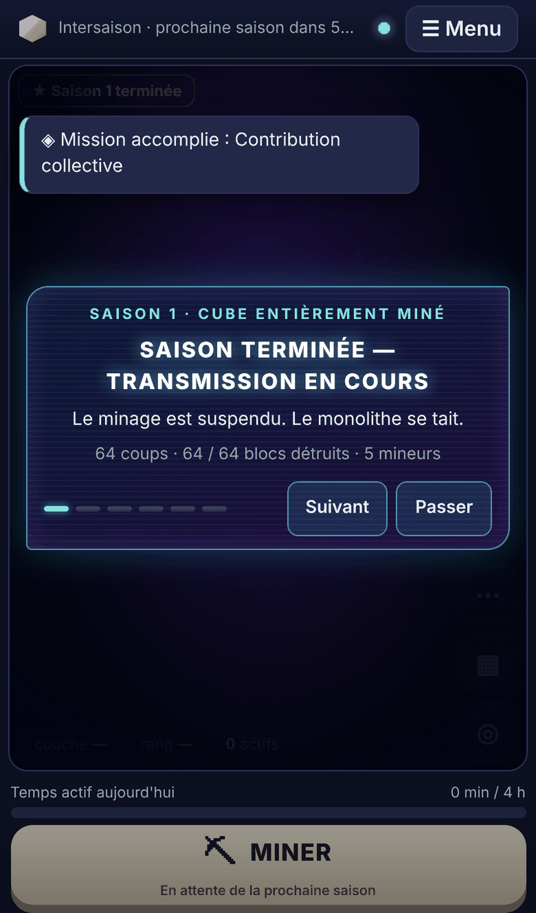
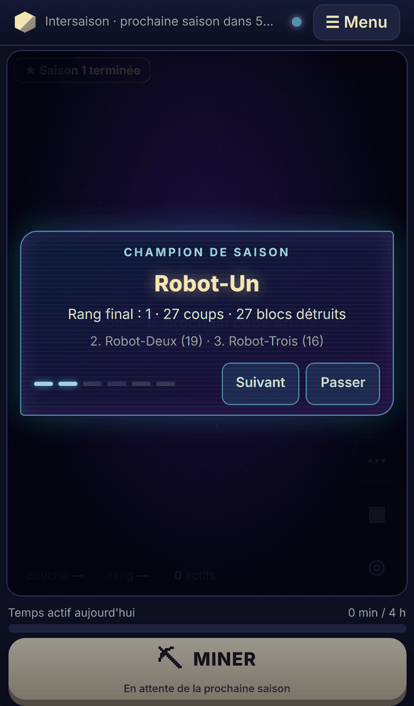
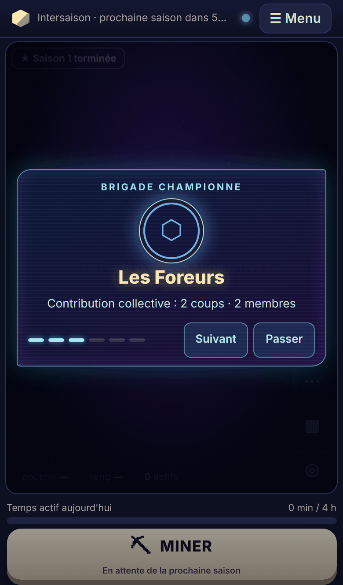
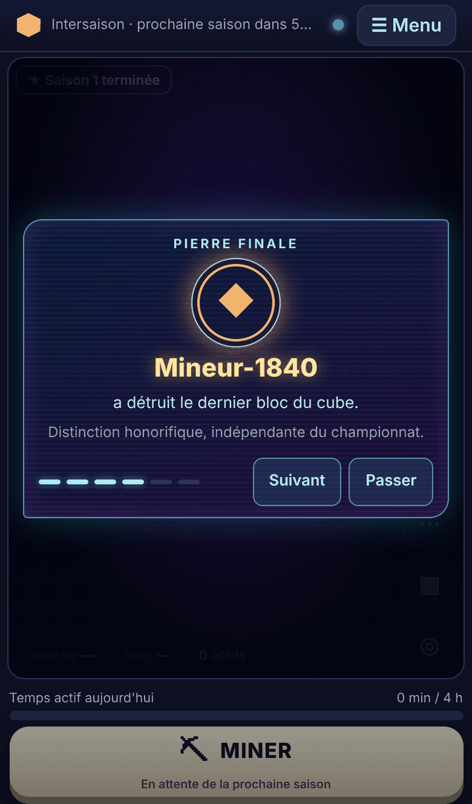
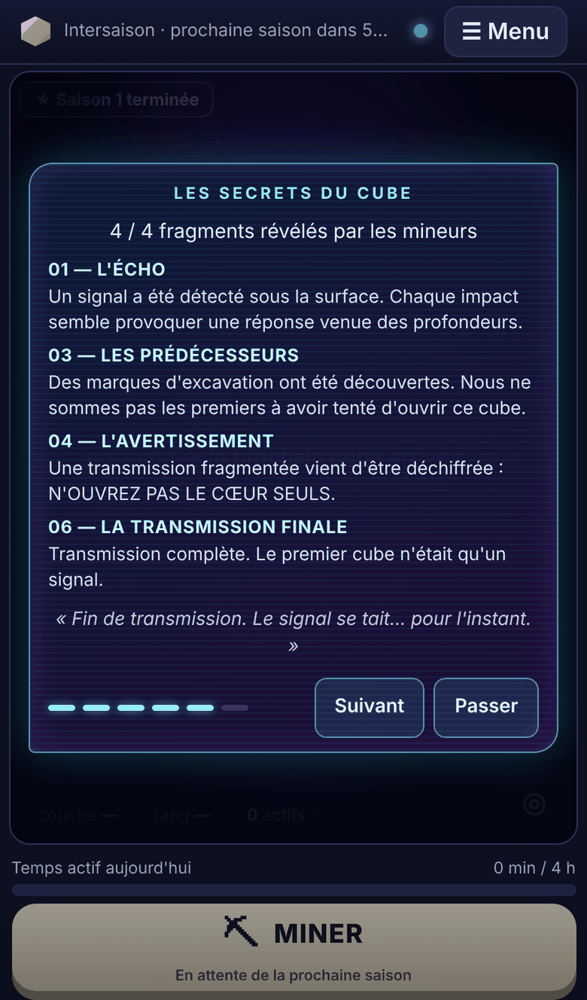
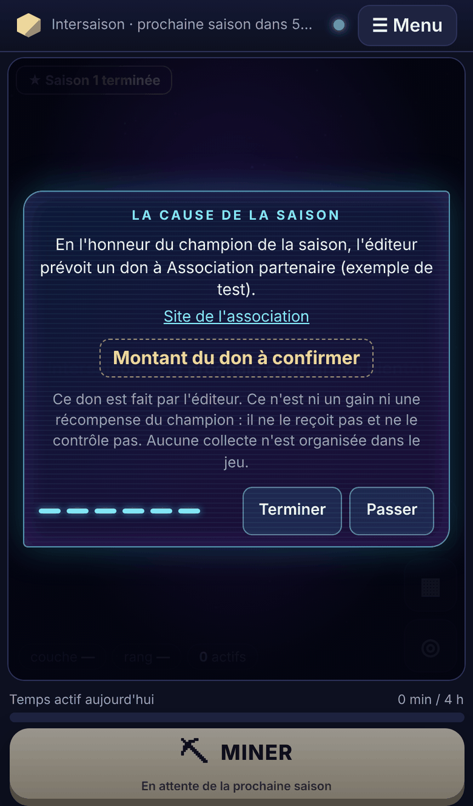

# Cérémonie de fin de saison et Hall des champions

À la fin de chaque saison, tous les joueurs connectés voient la même séquence d'environ 41 s, synchronisée sur l'instant de clôture décidé par le serveur. Les résultats sont ensuite archivés de façon stable dans le **Hall des champions**, consultable et rejouable lors des saisons suivantes. La bêta privée de 48 heures n'est **pas** commencée.

## Audit préalable (ce qui existait)

| Élément | Constat | Décision |
|---|---|---|
| Clôture | `GameEngine.endSeason()` est appelé par le dernier bloc, par l'échéance (`tick`) ou par l'administration. Champion, brigade championne, Pierre finale et classement archivé (`season_results`) sont écrits dans une seule transaction. | Réutilisée telle quelle. L'archive est ajoutée **dans cette même transaction**. |
| Classement | Ordre : coups, puis antériorité du score, puis identifiant. La brigade championne est la première brigade **éligible** (effectif minimal) ayant des coups. | Inchangé. L'archive reprend `season_results`, et un test vérifie qu'elle respecte cet ordre. |
| Reprise après crash | `recoverCompletedSeason` clôture au démarrage une saison dont le dernier bloc est enregistré mais la clôture absente. | Inchangé. L'archive est créée à ce moment-là, une seule fois. |
| Clôture unique | Le moteur refusait une seconde clôture en mémoire, mais `store.endSeason` ne contrôlait rien : la base n'empêchait pas une seconde clôture. | **Renforcé** : la mise à jour exige une saison encore active, sinon tout est annulé. L'archive est une clé primaire, insérée par un `INSERT` simple. |
| Noms | `seasonInfo` recalculait le nom du champion à partir du joueur **actuel** : un changement de pseudo réécrivait l'histoire. | L'archive fige les noms à la clôture. |
| Fin de saison côté client | Un simple dialogue texte. | Remplacé par la cérémonie. L'ancien dialogue ne sert plus que de repli si l'archive manque. |
| Don | `DONATION_*` existe déjà dans la configuration (association envisagée, note), sans montant ni transaction. | Réutilisé. Le montant reste « à confirmer » tant que l'administration ne l'a pas saisi. |

## Déclenchement et fiabilité

| Exigence | Mise en œuvre |
|---|---|
| Trois causes de fin | Dernier bloc (`completed`), échéance (`timeout`, datée de l'échéance), clôture par l'administration (`admin`). Le serveur décide seul. |
| Une seule clôture | Plusieurs barrières : traitement séquentiel des coups dans un processus unique ; mise à jour conditionnée à `status = 'active'` ; archive unique par clé primaire. Une seconde tentative échoue sans rien écrire. Testé : deux joueurs sur le dernier bloc, double appel, insertion directe en base, seconde clôture par l'API (400). |
| Redémarrage brutal | La clôture et son archive forment une seule transaction : soit tout est écrit, soit rien. Si l'arrêt survient entre le dernier coup et la clôture, la saison est clôturée une seule fois au démarrage. Testé en simulation et avec un **vrai SIGKILL** au moment de la clôture. |
| Aucune récompense en double | Champion, brigade, Pierre finale et distinctions sont attribués une seule fois. Revoir la cérémonie relit l'archive et ne change rien, ce qui est vérifié. |
| Données validées | L'archive est construite à partir de l'état enregistré : classement archivé, contributions, blocs, découvertes **révélées**, distinctions. |

## Déroulé visuel (six moments, 41 s)

| Moment | Durée | Contenu |
|---|---:|---|
| A — Le silence du cube | 6 s | Le minage est suspendu (bouton Miner désactivé). Une impulsion cyan et violette traverse la scène, et un voile nuit-violet change l'ambiance du ciel et du monolithe. Message « **SAISON TERMINÉE — TRANSMISSION EN COURS** », avec le bilan : coups, blocs détruits, mineurs. |
| B — Le champion | 7 s | Titre « Champion de saison », pseudo, rang final, coups et blocs, puis les 2e et 3e places. Sans contribution : « aucun champion n'est désigné ». |
| C — La brigade championne | 7 s | Emblème aux couleurs de la brigade, nom, contribution collective, nombre de membres. Sinon : « Aucune brigade qualifiée », avec le minimum exigé. |
| D — La Pierre finale | 6 s | Auteur du dernier bloc, présenté comme une distinction honorifique indépendante du championnat. Sinon : « Aucune Pierre finale n'a été attribuée », avec la raison (temps écoulé ou clôture). |
| E — Les secrets du cube | 8 s | Uniquement les fragments **réellement révélés** (titre et texte), et le nombre révélé sur le total. Les fragments verrouillés ne sont ni nommés ni décrits. La séquence se termine par une transmission d'ambiance (« Le signal se tait… pour l'instant »), qui n'annonce ni découverte ni récompense. |
| F — La cause de la saison | 7 s | L'association partenaire configurée, ou « Association partenaire à annoncer ». **« Montant du don à confirmer »** tant que l'administration n'a pas saisi de montant. Mention explicite : le don est fait par l'éditeur ; ce n'est ni un gain ni une récompense du champion, qui ne le reçoit pas et ne le contrôle pas ; aucune collecte n'est organisée. |

- **Synchronisation** : chaque navigateur calcule le moment en cours à partir de l'instant de clôture (`closedAt`), corrigé par l'écart avec l'horloge du serveur. Un joueur qui se connecte ou se reconnecte pendant la cérémonie la rejoint au même moment que les autres, ce qui est testé.
- **Commandes** : « Suivant » avance d'un moment, « Passer » ferme la cérémonie. Elle se ferme d'elle-même à la fin.
- **Jamais bloquante** : elle couvre seulement la scène. La barre du haut, le menu et la barre d'action restent utilisables, et le menu s'ouvre pendant la cérémonie (testé).
- **Joueur qui revient après la fin** : si la saison s'est terminée il y a moins de 48 h et qu'il ne l'a pas encore vue sur cet appareil, la cérémonie lui est proposée une fois, depuis le début, et reste passable.
- **Revoir** : bouton « Revoir la cérémonie » dans le Hall. La lecture est seule à l'œuvre : l'archive est identique avant et après (testé).
- **Les deux rendus** : tout est en DOM au-dessus du canevas, donc identique en monolithe et en classique.
- **Animations réduites** : ni impulsion, ni apparitions progressives, ni flou ; le texte s'affiche directement.
- **Effets légers** : CSS seulement (dégradés, une impulsion, de courtes apparitions), sans aucune dépendance ajoutée.

## Hall des champions (archivage)

L'onglet **Saisons** du menu présente une carte par saison terminée :
- numéro et nom ;
- dates de début et de fin, et cause de la fin ;
- champion, brigade championne (avec son emblème) et Pierre finale ;
- contribution totale (coups, mineurs, blocs) ;
- découvertes révélées ;
- distinctions ;
- cause de la saison ;
- bouton « Revoir la cérémonie ».

**Fonctionnement de l'archivage**
- Table `season_archives` : une ligne par saison, avec le JSON de l'archive, l'instant de clôture et le montant du don.
  - L'archive est écrite **une seule fois**, dans la transaction de clôture. Seul `donation_amount` est modifiable ensuite, par `POST /api/admin/season/:id/donation` avec `{ "amount": "500 €" }`, ou `null` pour revenir à « à confirmer ». La saisie est validée : 1 à 60 caractères, sans balise.
- Lecture :
  - `GET /api/hall` : toutes les saisons terminées, la plus récente d'abord ;
  - `GET /api/hall/:id` : une saison ;
  - `welcome.ceremony` : la dernière saison terminée ;
  - `seasonEnded.archive` : la saison qui vient de se terminer.
- Ces champs sont optionnels et `PROTOCOL_VERSION` ne change pas.
- **Saisons closes avant cette version** : leur archive est construite une fois, à la première lecture, à partir des résultats enregistrés. Le nombre de membres de leur brigade championne est alors celui du moment de la lecture.
- **Distinctions** :
  - les titres de saison (Champion de saison, Brigade championne, Pierre finale) sont affichés ;
  - les distinctions de brigade restent **privées**, comme demandé : seul leur **nombre** est archivé et affiché.

## Tests exécutés

- `npm test` : **205 tests**, tous réussis. Il y en avait 192 ; 13 sont nouveaux.
  - `tests/ceremony.test.ts` (12 tests) :
    - déroulé et synchronisation ;
    - **dernier bloc frappé par deux joueurs au même instant** (une seule clôture, une seule Pierre finale, archive unique, seconde clôture refusée) ;
    - départage du champion conforme au serveur ;
    - **expiration du temps** sans cube terminé (fragments verrouillés absents) ;
    - **clôture administrative et saison sans contribution** ;
    - **brigade non qualifiée** puis qualifiée ;
    - archive figée malgré un changement de pseudo ;
    - **nouvelle saison** après l'ancienne, avec l'archive de la première inchangée ;
    - cause et confirmation du don ;
    - saison antérieure ;
    - **archives après redémarrage** et fenêtre de crash ;
    - WebSocket et HTTP : mêmes résultats pour tous, **reconnexion pendant la cérémonie**, Hall, don, seconde clôture refusée.
  - `tests/crash.test.ts` (1 test) : **SIGKILL réel** juste après que deux joueurs frappent le dernier bloc. Après deux redémarrages successifs : une seule archive, une seule Pierre finale (l'auteur réel du dernier coup), un Hall identique, et la même archive envoyée à un nouveau joueur.
- `npm run e2e:ceremonie -- --rendu monolithe` : **20/20**. `--rendu classique` : **20/20**. Le scénario :
  - un téléphone, un ordinateur et un navigateur en animations réduites ;
  - le téléphone détruit le dernier bloc par l'interface ;
  - les six moments vérifiés un à un ;
  - même moment sur les deux navigateurs ;
  - connexion pendant la cérémonie ;
  - menu utilisable ; « Passer » ; Hall et « Revoir » (archive inchangée) ;
  - joueur qui revient après la fin ;
  - saison 2 clôturée par l'administration sans aucun coup (aucun champion, aucune brigade, aucune Pierre finale, aucun fragment inventé) ;
  - aucune erreur JavaScript.
- Les autres suites passent toujours :
  - `npm run e2e` : **31/31** sur chaque rendu. La vérification de fin de saison, qui attendait l'ancien dialogue, lit maintenant le champion dans la cérémonie ; c'est la même vérification ;
  - `e2e:decouvertes` : **23/23** et **21/21** ;
  - `e2e:missions` : **16/16** sur chaque rendu ;
  - `e2e:brigades` : **14/14** sur chaque rendu.
- `npm run typecheck` et `npm run build` : OK.

## Performances observées

Chromium sans affichage, rendu logiciel, émulation iPhone 13, mesure pendant les 2 premières secondes de la cérémonie (impulsion et voile). **Aucune mesure sur téléphone réel.**

| Rendu | CPU du téléphone | Images/s | Image la plus longue |
|---|---|---:|---:|
| Monolithe | normal | 60 à 61 | 22 à 25 ms |
| Classique | normal | 60 | 21 à 24 ms |
| Monolithe | ralenti × 4 | 58 | 46 ms |
| Classique | ralenti × 4 | 60 | 31 ms |

- **Côté serveur** : la construction de l'archive ne s'exécute qu'une fois par saison, à la clôture (quelques requêtes indexées). Les coups ordinaires ne coûtent rien de plus.
- **Taille du client** : 126,6 Ko de JavaScript (41,9 Ko compressés), sans dépendance ajoutée.

## Limites restantes

- **Montant du don** : c'est un texte saisi par l'administration (« 500 € »). Aucun paiement n'est relié, et c'est voulu.
- **Association « exemple de test »** : elle n'apparaît que dans les captures. Sans configuration, la cérémonie affiche « Association partenaire à annoncer ».
- **Mémoire du « déjà vu »** : la cérémonie proposée au retour est mémorisée par appareil, comme les annonces de découverte.
- **Saisons antérieures** : pour une saison close avant cette version, l'effectif de la brigade championne est celui du moment de la première lecture.
- **Ambiance** : elle est rendue par un voile et une impulsion au-dessus de la scène. Le monolithe lui-même n'est pas redessiné : c'est voulu pour fonctionner pareil en classique, sans coût de dessin.
- **Performances** : mesurées en émulation seulement.

## Captures

Elles proviennent du test navigateur : cube de démonstration de 4 couches, deux joueurs réels et trois robots.

| Moment | Téléphone (monolithe) |
|---|---|
| A — Silence |  |
| B — Champion |  |
| C — Brigade |  |
| D — Pierre finale |  |
| E — Secrets |  |
| F — Cause |  |

Ordinateur :
- [champion (monolithe)](captures/ceremonie/ceremonie-b-champion-bureau-monolithe.png) ;
- [secrets (monolithe)](captures/ceremonie/ceremonie-e-secrets-bureau-monolithe.png) ;
- [champion (classique)](captures/ceremonie/ceremonie-b-champion-bureau-classique.png) ;
- [clôture administrative sans contribution](captures/ceremonie/ceremonie-admin-bureau-monolithe.png).

Hall des champions :
- [téléphone](captures/ceremonie/hall-mobile-monolithe.png) ;
- [ordinateur](captures/ceremonie/hall-bureau-monolithe.png) ;
- [ordinateur (classique)](captures/ceremonie/hall-bureau-classique.png).

Animations réduites : [téléphone](captures/ceremonie/ceremonie-reduit-mobile-monolithe.png). Silence en rendu classique : [téléphone](captures/ceremonie/ceremonie-a-silence-mobile-classique.png).
