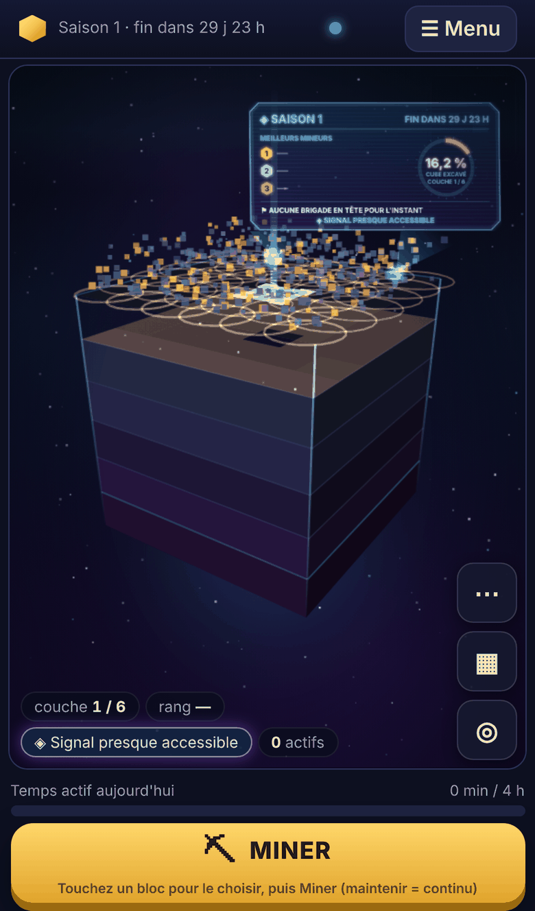
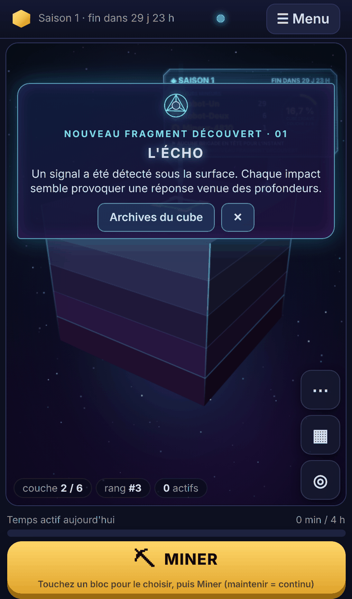
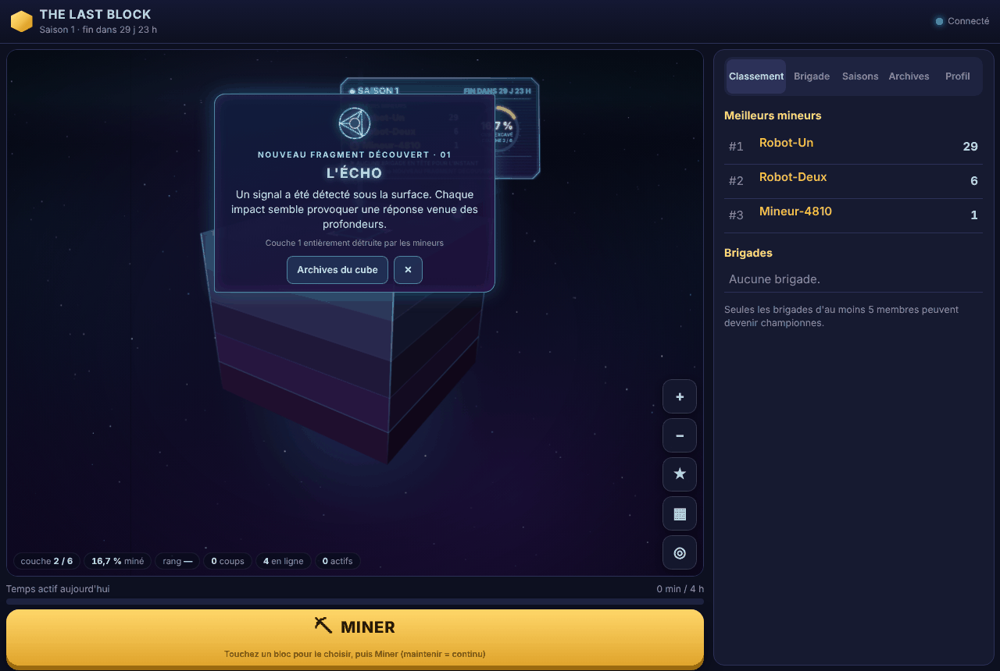
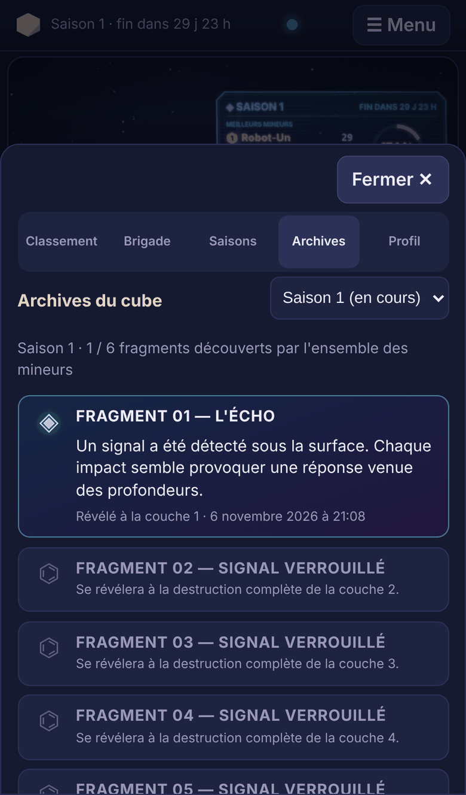
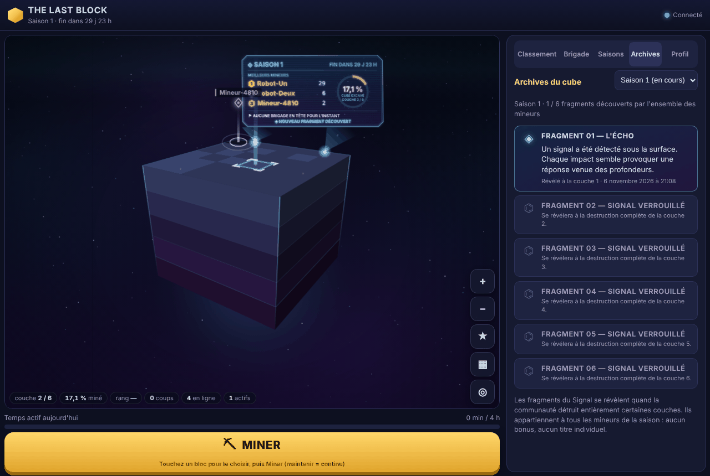
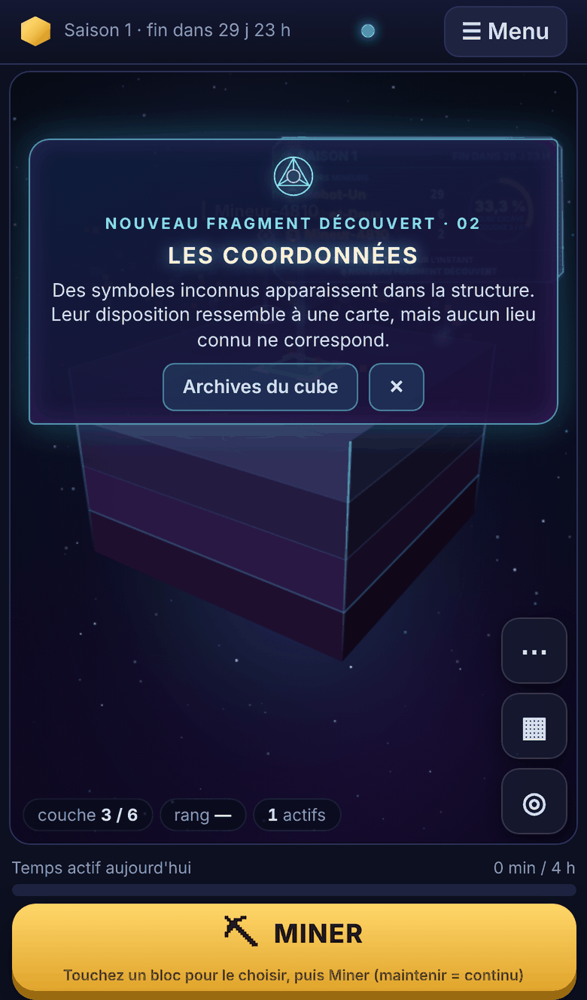

# Découvertes collectives — « Le Signal » (saison 1)

À mesure que la communauté détruit des couches entières du cube, des fragments d'un message venu d'une technologie inconnue se révèlent. Tous les joueurs découvrent la même chose au même moment. Aucun joueur ne possède de secret exclusif, et aucune découverte ne donne d'avantage.

Ce document décrit ce qui a été livré, comment cela fonctionne, comment c'est testé, et les limites restantes. Les missions, les objectifs de brigade, la cérémonie de fin de saison et la mini-saison ne sont **pas** commencés.

## Conformité au cahier des charges

| § | Exigence | Réalisation |
|---|---|---|
| 1 | Découverte mondiale, aucun secret exclusif | Un seul journal par saison, identique pour tous. Diffusé à tous les connectés, et inclus dans l'état complet envoyé à chaque (re)connexion. |
| 2 | Six fragments ordonnés, configurables, hors du code | `server/content/discoveries.json` : identifiant stable, numéro, titre, texte, ordre et profils de déclenchement. Fichier validé au démarrage. |
| 3 | Repères 10/25/45/65/85 % puis dernière couche ; couches strictement croissantes ; figées pour la saison | Calcul unique au démarrage de la saison (`planDiscoveryLayers`), enregistré en base avec les titres et les textes. Une modification ultérieure de la configuration ne touche pas la saison en cours. |
| 3 | Révélation à la destruction **complète** de la couche, validée par le serveur | Le même enregistrement en base inscrit le coup qui achève la couche et la révélation du fragment. |
| 3 | Fin de saison avant la fin du cube | Les fragments non découverts restent verrouillés, y compris dans les archives. |
| 3 | Moins de couches que de fragments | Jamais deux fragments sur une même couche. Si le profil est demandé explicitement (administration), il est refusé. Si c'est le profil par défaut, la saison démarre **sans découverte** et l'anomalie est signalée au démarrage du serveur et dans les archives. |
| 4 | Indices à 80 % et 95 % de la couche, sans rien dévoiler | « Anomalie détectée » puis « Signal presque accessible », calculés sur l'état confirmé de la couche. Le navigateur ne reçoit ni titre ni texte avant la révélation. |
| 4 | Enregistrement définitif, diffusion, animation, titre et message, archives | Oui. L'animation est courte, ne bloque pas le jeu et respecte les animations réduites. |
| 4 | Joueurs connectés après la révélation | Même historique, mêmes dates. Un joueur qui était absent voit l'annonce une fois à son retour. Un nouveau joueur trouve tout dans les archives. |
| 5 | Découverte collective, aucun avantage, aucun titre | Score, temps de jeu et profil de l'auteur du dernier bloc inchangés (testé). Son identifiant est conservé dans le seul journal technique, jamais envoyé au navigateur. Classement, brigades et Pierre finale inchangés. |
| 6 | Archives du cube | Onglet « Archives » du menu existant : nom de la saison, fragments révélés (titre, message, couche, date), fragments inconnus en symboles verrouillés. Les saisons passées restent consultables. Une seule interface sert les deux rendus. |
| 7 | Impulsion cyan et violette, symbole, titre progressif, message, panneau | Annonce en DOM au-dessus de la scène, donc commune aux deux rendus et sans coût pour le dessin du cube. Le panneau holographique et le panneau classique affichent « Nouveau fragment découvert » pendant une minute, puis l'indice en cours. Aucune refonte du cube ni de la caméra. |
| 8 | Persistance et sécurité | Voir plus bas. |
| 9 | Profil de démonstration à quatre fragments | Profil `mini-48h` (L'Écho, Les Prédécesseurs, L'Avertissement, La Transmission finale) aux repères 25/50/75 % puis dernière couche. Il suffit de `DISCOVERY_PROFILE=mini-48h`. La mini-saison elle-même n'est pas construite. |
| 10 | Tests | Voir plus bas : unitaires, WebSocket, SIGKILL réel, deux navigateurs sur chaque rendu. |

## Fonctionnement

```
Coup accepté (mine)            ── limites inchangées : 5 coups/s, 4 h/jour, idempotence
  └─ transaction SQLite
       ├─ bloc : PV - 1, journal des coups, contributions (comme avant)
       └─ si c'était le dernier bloc de la couche :
            UPDATE discoveries SET revealed_at = …
            WHERE couche = L AND revealed_at IS NULL
              AND plus aucun bloc vivant dans la couche (vérifié en base)
  └─ après COMMIT : événement « discovery », puis « layer », ou la clôture si c'était la dernière couche
       └─ serveur WebSocket : le coup est diffusé d'abord, puis le message « discovery » à tous
            └─ navigateur : annonce, archives, panneau
```

- **Un seul chemin d'écriture** : la révélation n'existe que dans `GameEngine.mine()`. Elle hérite donc des contrôles anti-triche existants. Aucun message du navigateur ne peut la déclencher. Des messages forgés (`discovery`, `reveal`) sont sans effet, et c'est testé.
- **Calcul des couches** (`shared/discoveries.ts`) :
  1. Chaque repère est arrondi au plus proche, avec au minimum la couche 1.
  2. Un repère qui rejoint le précédent passe à la couche suivante.
  3. Enfin, on recule depuis la dernière couche pour rester dans le cube.

  | Couches | Fragments 01 → 06 |
  |---|---|
  | 32 (défaut) | 3, 8, 14, 21, 27, 32 |
  | 48 | 5, 12, 22, 31, 41, 48 |
  | 6 (tests) | 1, 2, 3, 4, 5, 6 |

  Le profil `mini-48h` sur 8 couches donne les couches 2, 4, 6 et 8.

### Persistance et sécurité

| Exigence | Mise en œuvre |
|---|---|
| Une découverte par saison | Table `discoveries`. Unicité sur (saison, fragment), (saison, ordre) et (saison, couche). La mise à jour n'a lieu que si `revealed_at IS NULL`. |
| Coups simultanés | Le moteur traite les coups un par un. La base vérifie en plus que la couche est vide et que le fragment n'est pas déjà révélé. Testé : deux joueurs sur le même dernier bloc donnent une seule révélation, et une seconde tentative directe en base ne change rien. |
| Redémarrage brutal | La révélation est enregistrée dans la même transaction que le coup : il n'existe pas d'état « couche détruite sans découverte ». Testé avec un vrai SIGKILL : mêmes fragments, mêmes dates. |
| Couche détruite mais fragment non marqué (base antérieure, incident) | Réconciliation idempotente à chaque chargement de saison. La date retrouvée est celle du dernier bloc détruit de la couche, pas l'heure du redémarrage. Testé, ainsi que l'absence de doublon aux chargements suivants. |
| Bonne saison | Chaque ligne et chaque événement porte l'identifiant de la saison. Le client ignore un événement d'une autre saison. |
| Archives après la fin de la saison | Journal conservé en base. Consultable par `GET /api/discoveries?season=<id>`, et sélecteur de saison dans les archives. |
| Anciens clients | `PROTOCOL_VERSION` est inchangée. Le champ `discoveries` de `welcome` est optionnel et le message `discovery` est nouveau : un ancien client les ignore. |
| Saison créée avant cette fonctionnalité | Plan créé au chargement avec le profil configuré. Les couches déjà détruites sont révélées par réconciliation. |
| Textes secrets | Absents du code du navigateur (vérifié dans le paquet compilé) et absents de toute donnée envoyée pour un fragment verrouillé (ni titre ni texte). |

### Configuration

- `server/content/discoveries.json` :
  - textes et profils, validés au démarrage (identifiants, doublons, repères, fragments inconnus) ;
  - une modification s'applique aux saisons qui démarrent ensuite, après recompilation et redémarrage ;
  - le fichier est copié dans `dist/` par `npm run build`.
- `DISCOVERY_PROFILE` : `standard` (par défaut), `mini-48h` ou `none`. Un nom inconnu empêche le serveur de démarrer.
- Administration : `POST /api/admin/season/start` accepte `discoveryProfile`. La réponse contient le journal de la nouvelle saison, où `invalidProfile` signale un profil inadapté.

### Interface

| Élément | Fichier | Rendus |
|---|---|---|
| Indice (pastille près des indicateurs) | `client/src/main.ts`, `shared/discoveries.ts` | les deux |
| Annonce de révélation | `client/src/discoveries.ts`, `index.html`, `style.css` | les deux (DOM au-dessus du canevas) |
| Archives du cube | `client/src/discoveries.ts` | les deux (panneau existant) |
| Ligne du panneau | `world/monolith/hologram.ts`, `world/billboard.ts` | holographique et classique |

- **Annonce non bloquante** :
  - le calque est transparent au toucher, seule la carte capte un toucher ;
  - le bouton Miner n'est jamais recouvert ;
  - la carte se ferme seule au bout de 11 s, ou avec ✕ ;
  - « Archives du cube » ouvre directement les archives.
- **Animations réduites** : ni impulsion, ni rotation, ni déchiffrement ; le titre s'affiche d'emblée.
- **Absence** : chaque navigateur retient les fragments déjà annoncés pour la saison. Au retour, un fragment révélé entre-temps est annoncé une fois. À la première visite, rien n'est rejoué.

## Tests exécutés

- `npm test` : **155 tests**, tous réussis. Il y en avait 133 avant ; 22 sont nouveaux.
  - `tests/discoveries.test.ts` (20 tests) :
    - plan des couches (32, 48, 6, 5, toutes tailles de 6 à 64, repères rapprochés), contenu et validation du fichier, profil inconnu ;
    - révélation exacte, sans révélation prématurée ni fuite de texte ; indices à 80 et 95 % ;
    - deux joueurs sur le dernier bloc ; aucun avantage ;
    - cube terminé (ordre des six fragments, puis clôture) ; échéance avec fragments verrouillés ; nouvelle saison avec archives indépendantes ;
    - profil incompatible signalé ou refusé ; profil `none` ;
    - redémarrage sans fermeture propre, réconciliation, saison antérieure, plan figé ;
    - WebSocket : diffusion identique aux deux joueurs, ordre découverte puis couche, reconnexion, nouveau joueur, messages forgés, API HTTP.
  - `tests/crash.test.ts` (1 test) : **SIGKILL réel** pendant une rafale de coups sur la couche suivante. Mêmes fragments et mêmes dates après redémarrage ; un fragment n'est révélé que si sa couche est vide ; invariants de la base.
  - `tests/hologram.test.ts` (1 test) : priorité de l'annonce sur le panneau.
- `npm run e2e:decouvertes -- --rendu monolithe` : **23/23**. `--rendu classique` : **21/21** (deux vérifications concernent le panneau holographique, propre au monolithe). Le scénario se déroule ainsi :
  - deux navigateurs : un téléphone tactile émulé et un ordinateur ;
  - des robots WebSocket réels préparent la couche ;
  - les indices apparaissent aux bons seuils sur les deux navigateurs ;
  - le téléphone sélectionne le dernier bloc d'un toucher et le mine ;
  - les deux navigateurs reçoivent la même découverte, avec un journal identique ;
  - le jeu continue pendant l'annonce ;
  - les archives sont vérifiées sur le téléphone et sur l'ordinateur ;
  - un navigateur se reconnecte, un joueur absent revient, un nouveau joueur arrive ;
  - les animations réduites sont vérifiées ;
  - aucune erreur JavaScript.
- Les deux suites navigateur existantes passent toujours : `npm run e2e -- --rendu monolithe` **31/31**, `--rendu classique` **31/31**.
- `npm run typecheck` et `npm run build` : OK.

Pour les tests navigateur, le cube fait 6 couches de 6 × 6 blocs à 1 PV, et la cadence est relevée à 100 coups/s **dans ce test seulement**, pour que les robots préparent une couche en quelques secondes. Les réglages de production ne changent pas.

## Performances observées

Chromium sans affichage, rendu logiciel, émulation iPhone 13. **Aucune mesure sur un téléphone réel.**

| Rendu | CPU du téléphone | Images/s pendant l'annonce | Image la plus longue | Coup → annonce chez l'autre joueur |
|---|---|---:|---:|---:|
| Monolithe | normal | 60 | — | 110 à 130 ms |
| Classique | normal | 60 | — | 106 à 126 ms |
| Monolithe | ralenti × 4 | 57 | 42 ms | 385 ms |
| Classique | ralenti × 4 | 54 | 53 ms | 413 ms |

- **Ce qui coûte peu** :
  - l'impulsion et la carte sont des animations CSS, composées par le navigateur, sans redessiner le cube ;
  - le titre se déchiffre en 0,9 s (une mise à jour de texte toutes les 50 ms) ;
  - le panneau holographique n'est repeint qu'au changement de son contenu.
- **Côté serveur** : rien n'est ajouté aux coups ordinaires. La requête de révélation ne s'exécute que sur le coup qui achève une couche.
- **Taille du client** : 110,6 Ko de JavaScript (36,9 Ko compressés), sans aucune dépendance ajoutée.

## Limites restantes

- **Profil inadapté au cube par défaut** : la saison démarre sans découverte, avec un avertissement au démarrage du serveur et dans les archives. C'est un choix délibéré : une erreur de configuration ne doit pas empêcher toute partie. On peut à la place rendre ce cas bloquant.
- **Arrondi des repères** : sur 32 couches, le fragment 01 arrive à la couche 3, soit 9,4 % au lieu de 10 %. Les autres écarts sont inférieurs à une couche.
- **Seuils des indices** : ils se comptent en blocs détruits de la couche, pas en points de vie.
- **Annonce « pendant votre absence »** : mémorisée par navigateur, pas par compte. Un joueur qui utilise deux appareils la verra une fois sur chacun.
- **Textes figés par saison** : une correction du texte d'un fragment ne s'applique qu'aux saisons suivantes. C'est voulu : les archives ne changent pas après coup.
- **Animation hors de la scène 3D** : elle est posée au-dessus de la scène, pas dans le cube. C'est voulu pour fonctionner pareil avec le rendu classique, sans coût de dessin.
- **Performances** : mesurées en émulation uniquement.
- **Langue** : textes en français seulement.

## Captures

Elles proviennent des tests navigateur : cube de démonstration de 6 couches et robots réellement connectés.

| | Téléphone (monolithe) | Ordinateur (monolithe) |
|---|---|---|
| Indice à 95 % |  | |
| Révélation |  |  |
| Archives du cube |  |  |
| Animations réduites |  | |

Rendu classique :
- [révélation sur téléphone](captures/decouvertes/signal-revelation-mobile-classique.png) ;
- [révélation sur ordinateur](captures/decouvertes/signal-revelation-bureau-classique.png) ;
- [archives sur téléphone](captures/decouvertes/signal-archives-mobile-classique.png).
