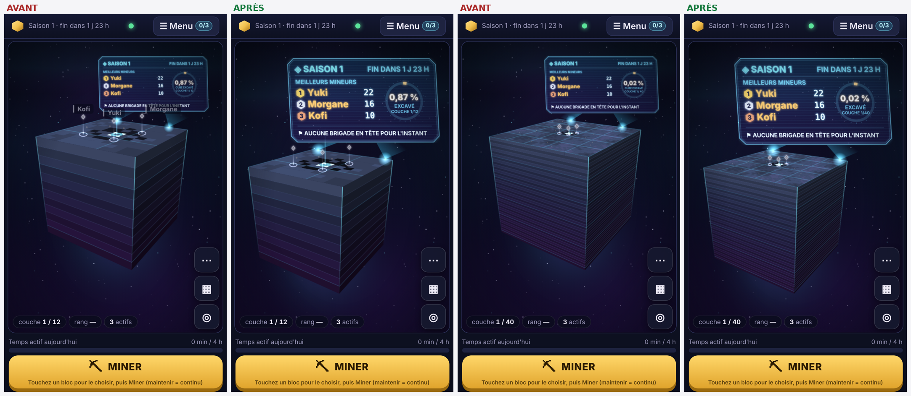
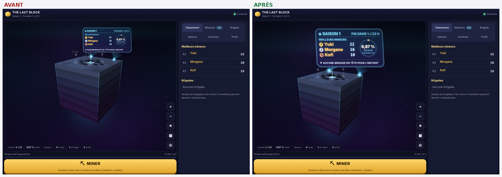
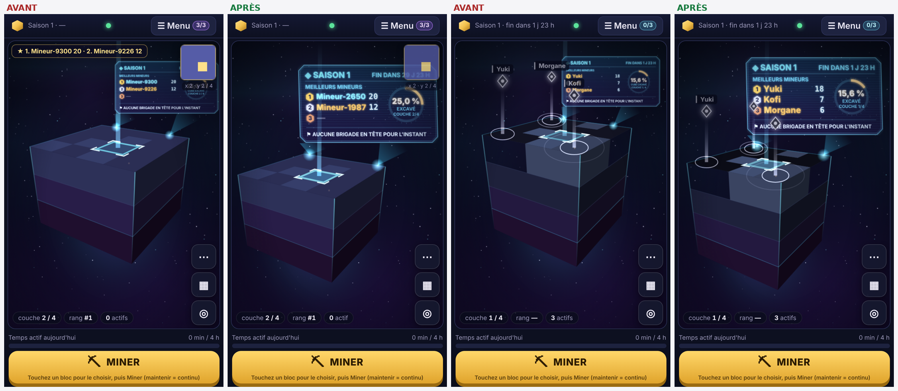
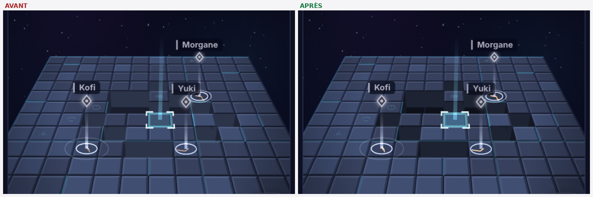
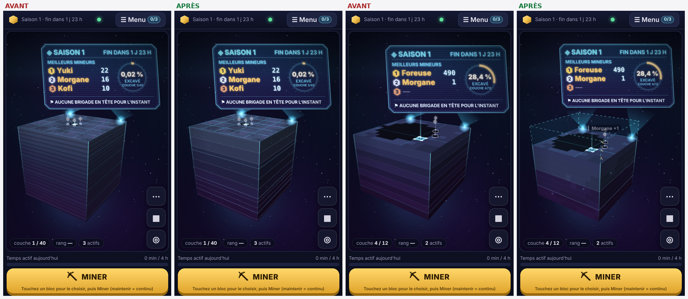
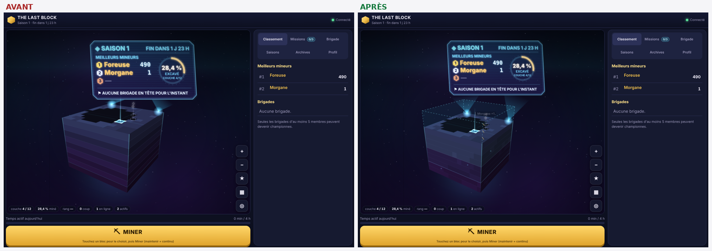
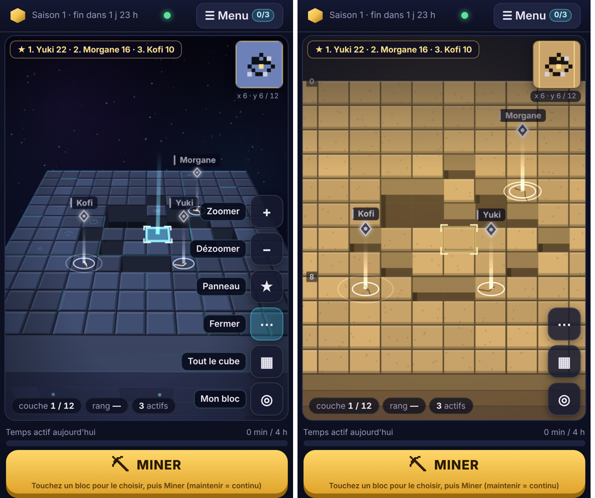
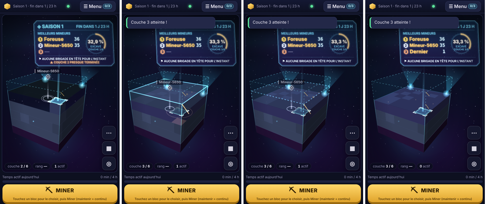
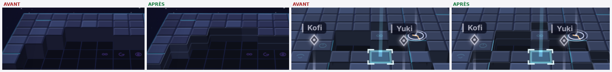

# Finition visuelle avant la bêta (points 1 à 6)

Retouches de présentation, **sans nouvelle mécanique**. Aucun changement du serveur ni du protocole.

## Ce qui a changé

| # | Problème constaté sur les captures | Correction |
|---|---|---|
| 1 | Mini-carte et coordonnées posées **sur l'écran holographique** (petits cubes, zooms intermédiaires). | Le rendu publie à chaque image la place de l'écran holographique et son opacité. La mini-carte s'efface dès qu'il passe dessous. Les pseudos des mineurs ne se posent plus dessus. |
| 2 | « 1 coups », « 1 actifs », « 0 actifs », et ailleurs « 1 membres », « 1 blocs détruits ». | Accord en nombre partout où un nombre est suivi d'un nom : singulier pour 0 et 1, pluriel au-delà (`client/src/text.ts`). Concerne les pastilles, l'écran holographique, le classement des brigades, la cérémonie, le Hall et l'onglet Brigade. |
| 3 | Le classement apparaît **deux fois** : bandeau en haut et écran holographique juste dessous. | Le bandeau se masque dès que l'écran holographique est **lisible** : au moins 35 % de la largeur, assez opaque, visible aux deux tiers. Le bandeau revient en vue de minage, quand l'écran est lointain et estompé. |
| 4 | Écran holographique illisible sur téléphone : libellés de 4 à 7 px, environ 150 px de large. | L'écran est plus large (1,5 arête au lieu de 1,1) et un peu plus haut (rapport 0,56). Les textes sont agrandis (pseudos 11 unités au lieu de 9, libellés 7 au lieu de 5,5). Les textes trop longs **rétrécissent avant d'être coupés**. Sur iPhone 13, l'écran fait 270 px sur 376, et les pseudos environ 16 px au lieu de 7 px. |
| 5 | Vue monumentale mal remplie : ensemble décentré, l'hologramme sortait même à droite du cadre une fois agrandi. | Le cadrage tient compte de l'écran holographique réel (largeur et hauteur). Il **centre** l'ensemble cube et écran, horizontalement et verticalement, au-dessus des pastilles du bas. Il occupe 94 % de la largeur ou 88 % de la hauteur utile. Le décalage ne s'applique qu'en vue monumentale : la vue de minage reste centrée sur le bloc visé. |
| 6 | Vue de minage : trous, blocs abîmés et bloc sélectionné peu contrastés. | Fonds et parois des puits plus sombres. Blocs abîmés assombris par palier (16 % au lieu de 10 %), avec des fissures plus visibles. Sélection plus lumineuse (remplissage 32 % au lieu de 16 %, cadre de 3 px). **Contraste mesuré entre bloc intact et trou, sur iPhone : 1,49 avant, 2,22 après.** |

## Effet secondaire assumé

En vue monumentale, le pseudo d'un mineur situé juste sous l'écran holographique n'est plus affiché, car l'étiquette ne peut pas être déplacée loin de son mineur sans tromper. Son marqueur (losange et faisceau) reste visible. En vue de minage, rien ne change.

## Vérifications

- **Tests unitaires** : 239 au total, dont 10 nouveaux dans `tests/finition.test.ts`.
  - Accords en nombre.
  - Règle de lisibilité de l'écran holographique et chevauchements.
  - Pseudos hors de la zone réservée.
  - Cadrage monumental pour des cubes de 4, 12 et 40 et des vues portrait, bureau et paysage : tout est à l'écran, centré à 2 px près, et remplit la zone.
  - Absence de décalage en vue de minage.
- **e2e** :
  - nouvelle vérification dans `e2e-browser` : en vue monumentale sur iPhone, l'écran holographique est entier, occupe au moins 55 % de la largeur, sans bandeau ni mini-carte ;
  - toutes les suites passent sur les deux rendus : e2e 32/32 en monolithe et 31/31 en classique, découvertes, missions, brigades, cérémonie, bêta.
- **Zoom intermédiaire** sur un cube de 4 (cas de la photo d'origine), le bandeau et la mini-carte sont masqués à chaque palier où l'écran est lisible :

  | Paliers testés | Valeur de `t` |
  |---|---|
  | ×1,03 | 0,97 |
  | ×1,07 | 0,87 |
  | ×1,12 | 0,68 |
  | ×1,18 | 0,42 |

Captures avant / après : `npm run build && NODE_PATH=$(npm root -g) npm run captures:finition -- --prefixe apres`. Ce script couvre les cubes de 4, 12 et 40, sur iPhone et ordinateur, en vues minage, panneau et monument.

| | |
|---|---|
| Vue monumentale, iPhone, cubes 12 et 40 |  |
| Vue monumentale, ordinateur |  |
| Petit cube (photo d'origine : bandeau et mini-carte sur l'écran) |  |
| Contraste en vue de minage |  |

---

# Finition 2 (points 7 à 11)

Toujours **sans nouvelle mécanique**, sans changement du serveur ni du protocole.

| # | Problème | Correction |
|---|---|---|
| 7 | Les faces du monolithe faisaient 40 rayures identiques : une « boîte » plutôt qu'une roche. | Les couches sont regroupées en **strates géologiques** de 2 à 5 couches d'épaisseur variable. Chaque strate a sa propre teinte et une ligne éclairée la sépare de la suivante. Une couture cyan apparaît toutes les trois strates. **Quand les couches sont assez grandes** (au moins 7 px), on voit en plus des plaques de pierre de longueurs inégales. Quelques runes lumineuses éparses complètent le tout. Tout est déterminé par la taille du cube : le dessin est identique pour tous les joueurs et ne change pas pendant la saison. |
| 8 | Vu de loin, un cube creusé à 28 % paraissait simplement plus petit. | **Volume déjà excavé** : la silhouette d'origine du cube s'affiche en pointillés au-dessus de la couche courante, avec un léger voile. Une graduation ambrée marque chaque couche retirée. Cet affichage n'existe qu'en vue monumentale et s'efface en vue de minage. L'écran holographique reste ancré au sommet d'origine : ses faisceaux s'allongent à mesure que le cube se creuse. Le cadrage ne bouge plus d'une couche à l'autre (vérifié par test). |
| 9 | Pseudos de mineurs voisins empilés en colonne, avec des fils croisés. | Les mineurs proches à l'écran (moins de 26 × 22 px) partagent **une seule étiquette** « Nom +n ». Le nom affiché est celui du mineur prioritaire : un allié, sinon le plus récent ou le plus proche. Ce regroupement vaut pour les deux rendus. |
| 10 | L'aide « Touchez un bloc pour le choisir, puis Miner (maintenir = continu) » restait affichée en permanence. | L'aide complète s'affiche tant que le joueur n'a pas fait 20 coups validés, puis devient « Maintenir = minage continu ». Ce passage est mémorisé sur l'appareil. |
| 11 | On ne savait pas ce que cachait le bouton « ⋯ ». | Sur téléphone, quand « ⋯ » est ouvert, **chaque commande affiche son nom** : Zoomer, Dézoomer, Panneau, Ma brigade, Fermer, Tout le cube, Mon bloc. |

## Performances (mesurées, pas estimées)

Mesures faites en vue monumentale sur un iPhone 13 émulé, processeur ralenti 4 fois, sur 120 images en rotation et 3 essais. La version « avant » est celle du commit précédent.

| Cube | Faces, avant | Faces, après | Image entière, avant | Image entière, après |
|---|---|---|---|---|
| 12 couches | 0,7 ms | 1,3 ms (plaques visibles) | 3,3 ms | 4,7 ms |
| 40 couches | 1,9 ms | 2,1 ms | 9,2 ms | 9,2 ms |

Sans optimisation, la première version des faces coûtait **7,1 ms**. Trois changements l'ont ramenée au niveau ci-dessus :
- les plaques et les runes sont calculées une fois par cube ;
- chaque ligne de couche ne demande que deux projections, les autres points en sont déduits par interpolation perspective exacte ;
- les plaques ne sont dessinées que lorsqu'elles se voient.

Le seuil de passage automatique en effets réduits reste à 14 ms. Le test de performance de `e2e-browser` donne 2,0 ms par image en moyenne, à 61 images/s.

## Vérifications

**Tests unitaires** : 242 au total, dont 3 nouveaux.
- Strates de 2 à 5 couches, couvrant tout le cube, déterministes et variées.
- Cadrage avec couches excavées : le volume d'origine et l'écran sont entiers à l'écran, avec un cadrage identique d'une couche à l'autre.
- Regroupement des pseudos.

**Tests navigateur** : nouvelles vérifications, toutes réussies sur les deux rendus.
- Les 6 commandes nommées quand « ⋯ » est ouvert, entièrement dans la vue.
- Aide courte après 20 coups, aide complète pour un débutant à 6 coups.
- Toutes les suites : e2e 33/33 et 32/32, découvertes, missions 17/17, brigades, cérémonie, bêta.

| | |
|---|---|
| Faces et volume excavé (iPhone) |  |
| Cube creusé (ordinateur) |  |
| Commandes nommées et pseudos groupés |  |

---

# Finition 3 : parois des puits et couche retirée

**Parois des puits (vue de minage).** Avant, les parois avaient une teinte uniforme par orientation. Désormais :
- elles prennent la teinte de la **strate** de la couche courante, la même que sur les faces du cube, et le fond du puits celle de la strate du dessous ;
- chaque bloc garde sa propre nuance de pierre (trois variantes) ;
- une **ligne de lit** fine court à mi-hauteur et un **rebord éclairé** souligne le haut de chaque paroi ;
- un trou se lit comme une coupe dans la roche.

Les parois restent plus sombres que les dessus, ce qui préserve le contraste mesuré en finition 1. Le rendu en vue de minage reste mesuré entre 2,0 et 2,8 ms par image, à 61 images/s, selon les exécutions.

**Couche retirée qui s'efface dans le pointillé.** Quand une couche est terminée, elle ne disparaît plus d'un coup :
- elle reste un instant comme une dalle de pierre ;
- son contour lumineux devient pointillé et elle s'efface dans le volume déjà excavé, en 1,4 s ;
- la graduation ambrée de cette couche s'allume au même moment.

La séquence est discrète en vue de minage et pleine en vue monumentale. Avec « mouvement réduit », il n'y a aucune animation et l'état final s'affiche tout de suite. L'effet est **purement visuel** : la nouvelle couche est jouable immédiatement.

**Test navigateur `npm run e2e:finition`** (6 vérifications) :
- une vraie couche est terminée par un autre joueur pendant qu'on regarde ;
- l'animation démarre puis se termine en moins de 2 s ;
- un second joueur en « mouvement réduit » ne voit aucune animation ;
- rien n'est rejoué au rechargement ;
- aucune erreur JavaScript.

| | |
|---|---|
| Couche retirée : avant, début, milieu, après |  |
| Parois des puits, avant / après (agrandi) |  |
