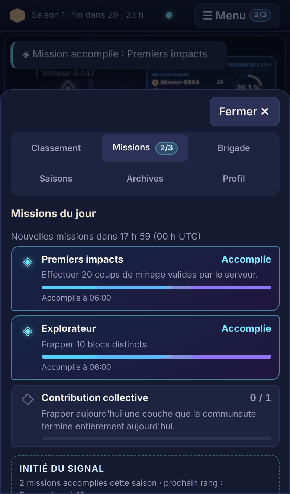
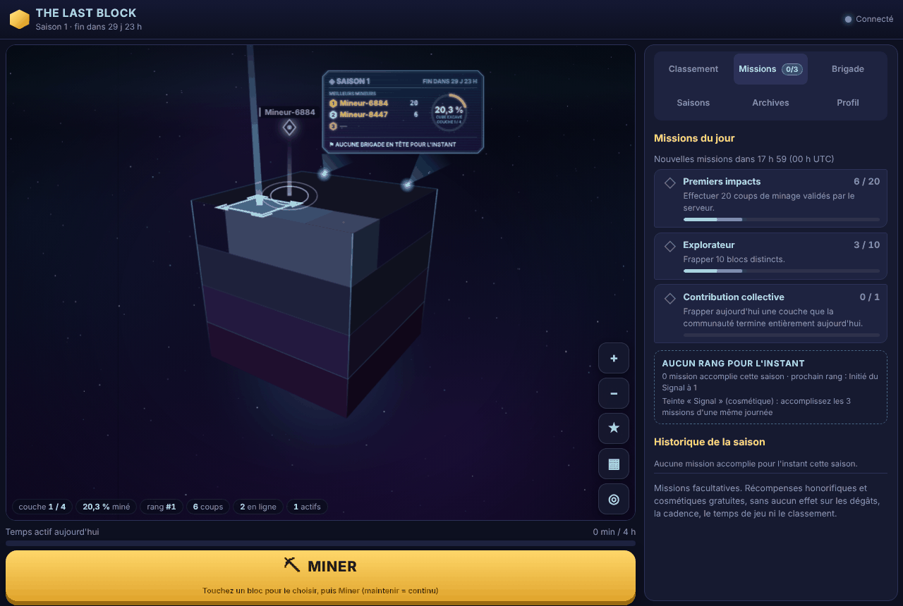
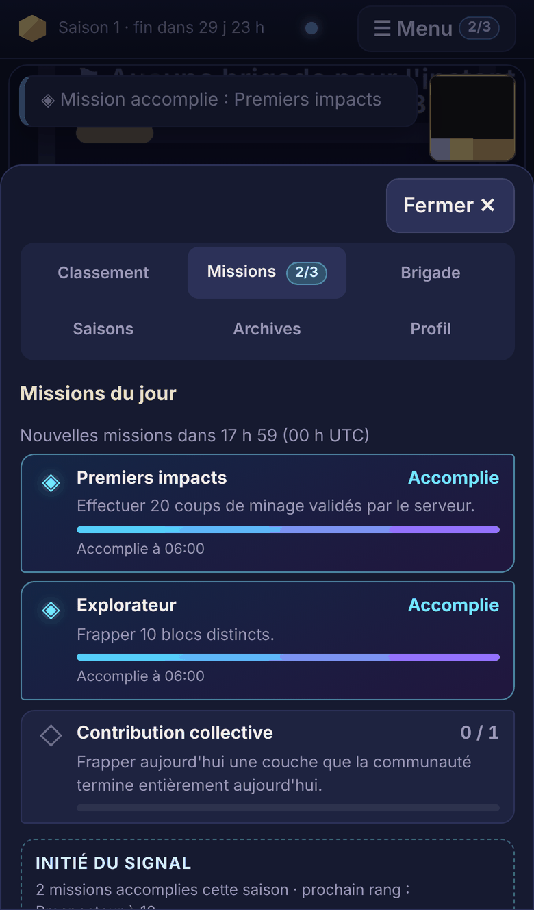
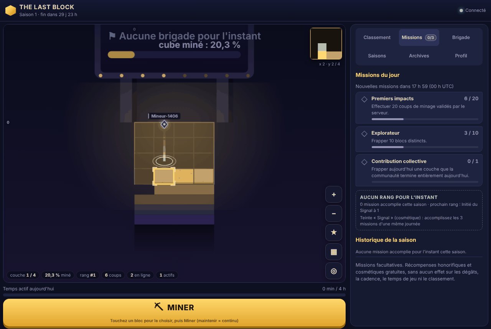
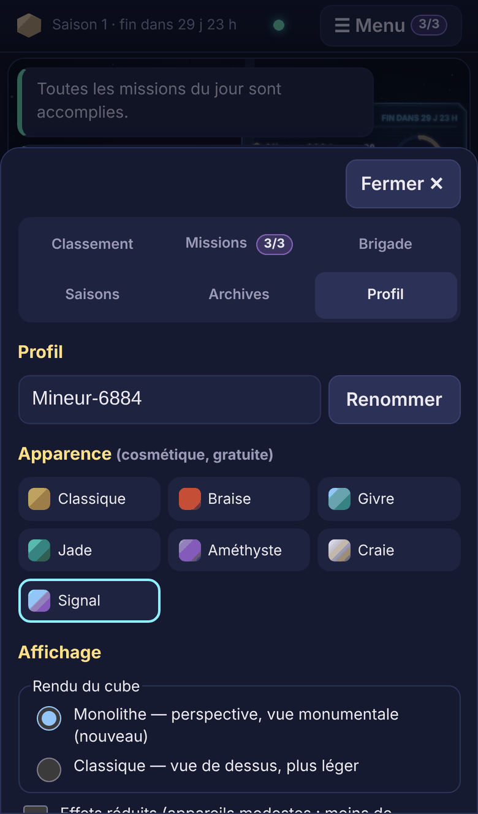
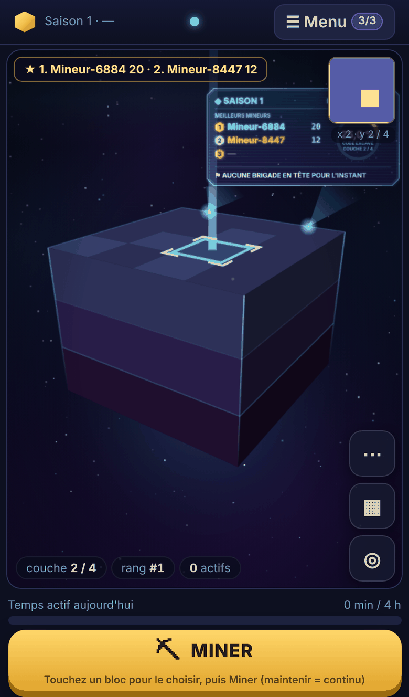

# Missions quotidiennes individuelles

Trois missions facultatives, renouvelées chaque jour à 00 h UTC, pour donner une raison de revenir. Elles ne touchent pas au classement compétitif et ne rapportent que des récompenses honorifiques ou cosmétiques gratuites. Les objectifs de brigade, la cérémonie et la mini-saison ne sont **pas** commencés.

Ce document couvre aussi les deux décisions de validation des découvertes (fin du document).

## Les missions

| Mission | Objectif (seuil configurable) | Compté à partir de |
|---|---|---|
| Premiers impacts | 20 coups validés | chaque coup accepté par le serveur |
| Explorateur | 10 blocs distincts | blocs différents frappés dans la journée (couche + position) |
| Contribution collective (**bonus**) | 1 couche | couche entièrement terminée aujourd'hui, que le joueur a frappée aujourd'hui |

- **Interprétation retenue pour la contribution collective** : le joueur doit avoir frappé la couche **le même jour UTC** que celui où elle se termine. Une couche frappée la veille puis terminée aujourd'hui ne compte pas, et c'est testé. Une mission du jour demande donc d'avoir joué ce jour-là. On peut assouplir la règle à toute la saison si vous le préférez.
- **Configuration** : seuils, textes, rangs et récompense se trouvent dans `server/content/missions.json`, validé au démarrage (types connus, seuils de 1 à 10 000, identifiants uniques, rangs croissants). Une modification s'applique au prochain démarrage du serveur.

## Récompenses (honorifiques et cosmétiques, gratuites)

- **Rang de saison**, d'après le nombre de missions accomplies : Initié du Signal (1), Prospecteur (10), Veilleur (30), Gardien du Signal (60). Il n'est visible que du joueur, dans son panneau, et n'apparaît dans aucun classement.
- **Teinte « Signal »** (cosmétique, permanente) : elle se débloque en accomplissant les **missions principales** d'une même journée, c'est-à-dire « Premiers impacts » et « Explorateur », entièrement réalisables par le joueur seul. La « Contribution collective » est un **objectif bonus** : elle compte pour le rang, mais n'est pas exigée, car elle dépend de l'achèvement d'une couche ce jour-là. *(Décision de validation du 7 novembre ; modification minimale : un champ `bonus: true` dans `missions.json`.)* Avant, elle est affichée verrouillée dans le Profil et le serveur refuse de l'appliquer (`skin_locked`). Comme toutes les teintes, `price: null` : rien ne s'achète.
- **Aucun effet sur le jeu** : rien sur les dégâts, la cadence, la limite de 4 h, le temps de jeu, le score ni le classement. Un test rejoue la même partie avec et sans missions et vérifie que résultats des coups, PV, scores, classement et temps de jeu sont identiques.

## Fonctionnement technique

```
Coup accepté (mine) : après les contrôles inchangés (doublon, 5 coups/s, 4 h/jour, règles du cube)
  └─ transaction SQLite du coup
       ├─ bloc, journal des coups, contributions, temps de jeu (comme avant)
       ├─ missions : avancement du jour (une ligne par joueur, saison et jour)
       │    └─ mission atteinte → INSERT OR IGNORE dans mission_completions
       │    └─ missions principales du jour → INSERT OR IGNORE dans player_unlocks (teinte)
       └─ dernier bloc d'une couche → joueurs ayant frappé cette couche aujourd'hui (daily_layer_hits)
            → « Contribution collective » pour chacun
  └─ après COMMIT : la mémoire est mise à jour, puis un message « missions » part vers le seul joueur concerné
```

| Exigence | Mise en œuvre |
|---|---|
| Progression uniquement côté serveur | Calculée dans `GameEngine.mine()`, après acceptation du coup. Le navigateur se contente d'afficher l'état reçu. |
| Pas de double comptage | Un coup renvoyé (même `actionId`) est reconnu comme doublon avant tout calcul. Chaque mission n'est enregistrée qu'une fois par jour (clé primaire, `INSERT OR IGNORE`). Testé en direct, après reconnexion et après SIGKILL. |
| 00 h UTC | Même découpage du jour que la limite de 4 h (`dayKey`). Les joueurs connectés reçoivent leurs nouvelles missions à minuit. |
| Historique de la saison | Table `mission_completions` (saison, joueur, jour, mission). Une nouvelle saison repart de zéro ; l'ancienne reste en base. |
| Redémarrage brutal | La progression est écrite dans la transaction du coup : un coup enregistré a toujours sa progression, et inversement. SIGKILL réel testé : la progression correspond exactement aux coups présents en base. |
| Requêtes légères | Une seule lecture par joueur et par jour, puis la mémoire prend le relais. Une écriture par coup tant qu'un objectif progresse (au plus 20 par jour avec les seuils actuels), puis **aucune**. La liste des joueurs d'une couche n'est lue qu'une fois, quand elle se termine. L'historique (30 derniers jours) n'est lu qu'à la connexion et quand une mission est accomplie. Tout est testé. |
| Cadence et 4 h | Inchangées : aucun réglage n'est modifié et aucun code ne les touche. |
| Paiement | Aucun. |

- **Coût mesuré** (moteur seul, base en mémoire, 200 joueurs × 60 coups) : 17 à 21 µs par coup sans missions, 21 à 24 µs avec, soit environ +3 à +4 µs par coup. La partie fluidité des tests navigateur est inchangée : 61 images/s, dessin moyen 2,4 ms en monolithe et 0,5 ms en classique.
- **Protocole compatible** :
  - le champ `missions` du message `welcome` est optionnel ;
  - le message `missions` est nouveau ;
  - la version du protocole reste la même.

## Interface

- **Onglet « Missions »** (avec la pastille `n/3`) dans le menu existant :
  - sur téléphone, il s'ouvre depuis ☰ Menu, qui porte aussi la pastille `n/3` ;
  - sur ordinateur, il est dans le panneau latéral.
- **Contenu du panneau** :
  - chaque mission avec sa barre de progression cyan-violet, l'heure d'accomplissement et le délai avant les nouvelles missions ;
  - le rang de saison et la récompense ;
  - l'historique de la saison (◈ accomplie, ◇ non accomplie).
- **Rien n'est posé sur la scène** : ni la surface de minage ni le panneau holographique ne sont masqués, et c'est vérifié. Comme l'interface est hors de la scène, elle est la même pour les deux rendus.
- **Notifications non bloquantes** à chaque mission accomplie, à la journée complète et au déblocage de la teinte.
- **Onglets** : les six onglets (Classement, Missions, Brigade, Saisons, Archives, Profil) tiennent sur deux rangées, lisibles à 360 px.

## Tests exécutés

- `npm test` : **174 tests**, tous réussis. Il y en avait 155 ; 19 sont nouveaux.
  - `tests/missions.test.ts` (16 tests) :
    - configuration et validation, plafonds ;
    - seuil exact de « Premiers impacts », coups refusés non comptés ;
    - **coups dupliqués** ; blocs distincts ;
    - contribution collective, y compris pour un joueur qui n'a pas donné le dernier coup, et le cas veille / jour ;
    - **deux joueurs simultanés** ; **changement de jour UTC** ;
    - historique et nouvelle saison, rang ;
    - teinte débloquée seulement après les missions principales d'une journée, y compris sans aucune couche terminée ;
    - **aucun effet sur le jeu** ;
    - nombre de lectures et d'écritures ; mémoire désynchronisée ;
    - **redémarrage** ;
    - WebSocket : deux joueurs en même temps, messages personnels, **reconnexion**, renvoi de coups déjà appliqués, **passage de minuit UTC** poussé aux joueurs connectés.
  - `tests/crash.test.ts` (1 test) : **SIGKILL réel** pendant une rafale de coups, dont des doublons. Après redémarrage, la progression correspond exactement aux coups présents en base et chaque mission n'est enregistrée qu'une fois. Les coups de la rafale renvoyés ensuite ne comptent pas une seconde fois.
  - `tests/discoveries.test.ts` (2 tests) : les décisions de validation des découvertes (voir plus bas).
- `npm run e2e:missions -- --rendu monolithe` : **15/15**. `--rendu classique` : **15/15**. Le scénario :
  - deux navigateurs, un téléphone tactile émulé et un ordinateur, qui minent **en même temps par l'interface** à la cadence réelle (5 coups/s) ;
  - progressions indépendantes ; pastilles et notifications ;
  - panneau dans le menu du téléphone ;
  - contribution collective pour les deux joueurs ;
  - teinte débloquée puis choisie dans le Profil ;
  - reconnexion avec le même état et l'historique ;
  - surface dégagée ; aucune erreur JavaScript.
- Les autres suites passent toujours :
  - `npm run e2e -- --rendu monolithe|classique` : **31/31** chacune ;
  - `npm run e2e:decouvertes` : **23/23** en monolithe, **21/21** en classique.
- `npm run typecheck` et `npm run build` : OK.

Le passage de minuit et le SIGKILL sont testés côté serveur, en WebSocket et avec un vrai processus. Les tests navigateur, eux, utilisent l'horloge réelle.

## Décisions de validation des découvertes (appliquées)

- **Profil incompatible avec le nombre de couches** : la création de la saison est refusée, avec une explication (réponse 400 à l'administration). Pour le démarrage automatique, l'erreur est journalisée une fois et exposée par `GET /api/health` (`seasonStartError`). Le serveur démarre toujours. Une saison sans découverte se configure explicitement (`DISCOVERY_PROFILE=none`, ou `discoveryProfile: 'none'`).
  - Conséquence pour les tests : ceux qui utilisent de petits cubes déclarent maintenant explicitement `none` (`NO_DISCOVERIES` dans `tests/helpers.ts`). Ce qu'ils vérifient ne change pas.
- **Conservés tels quels** : l'arrondi des repères, l'annonce « pendant votre absence » mémorisée par appareil pendant la bêta, et les textes archivés, qui ne changent plus.

## Limites restantes

- **Contribution collective** : il faut avoir frappé la couche le jour même (voir l'interprétation plus haut).
- **Rangs** : visibles du seul joueur ; ils ne s'affichent ni dans les classements ni sur les marqueurs. C'est voulu, pour ne rien changer au compétitif.
- **Heures affichées** : l'heure d'accomplissement est dans le fuseau du navigateur ; le jour des missions, lui, est en UTC (indiqué « 00 h UTC »).
- **Écart de quelques secondes à minuit** : à minuit UTC, un joueur connecté reçoit ses nouvelles missions dans la seconde. Entre-temps, un coup est déjà compté pour le nouveau jour.
- **Performances** : mesurées en émulation et sur le moteur seul ; rien sur un téléphone réel.

## Captures

Elles proviennent du test navigateur : deux joueurs réels sur un cube de démonstration de 4 couches.

| | Téléphone | Ordinateur |
|---|---|---|
| Missions du jour (monolithe) |  |  |
| Missions du jour (classique) |  |  |
| Teinte « Signal » débloquée |  | |
| Surface dégagée, pastille 3/3 |  | |
