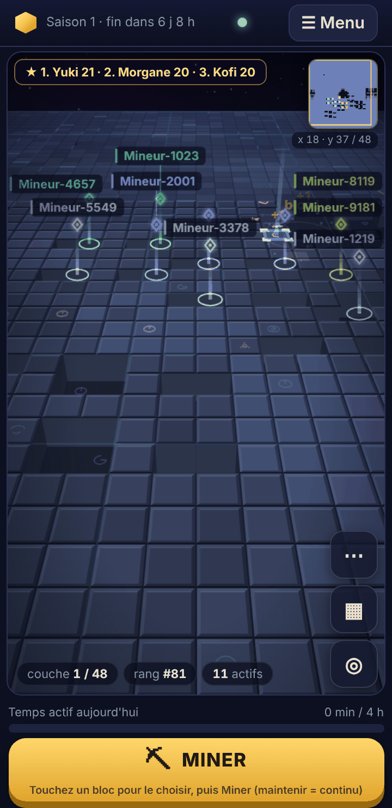
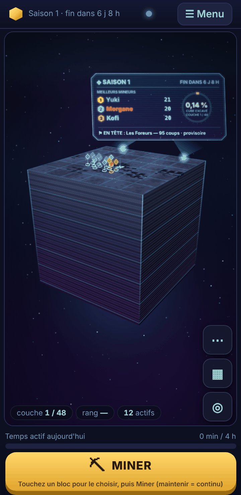
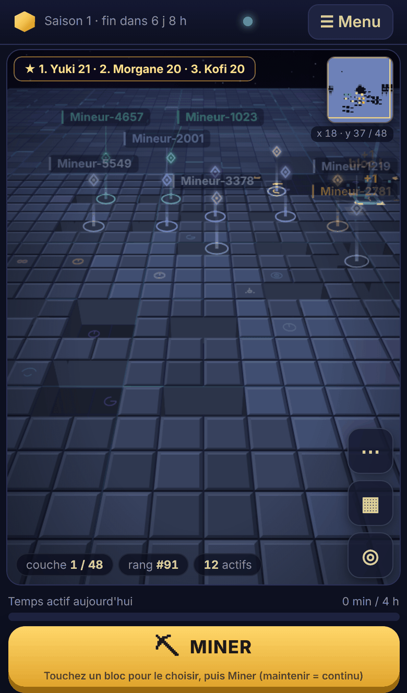
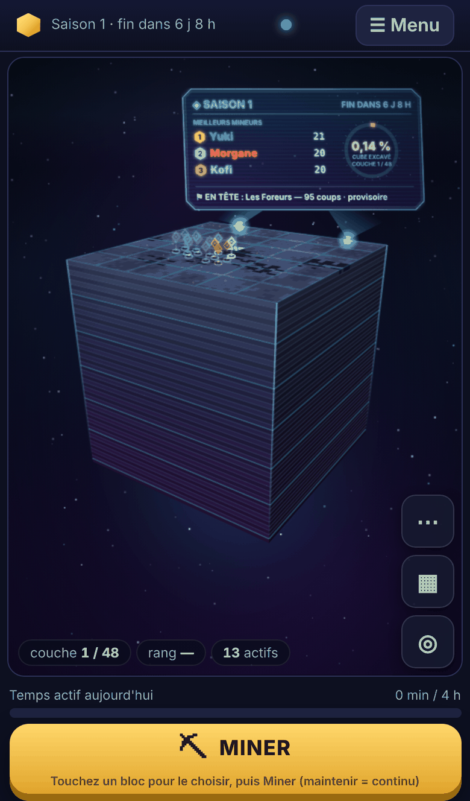
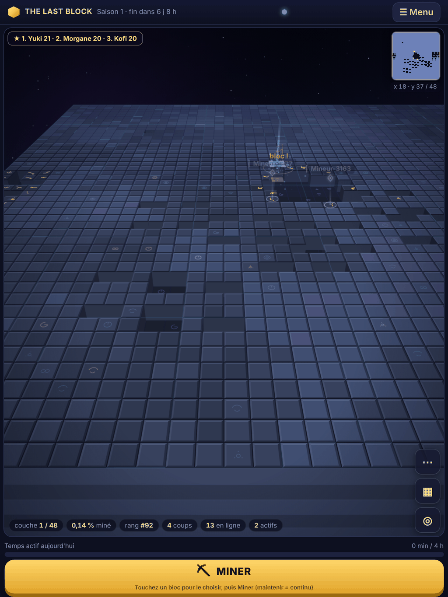
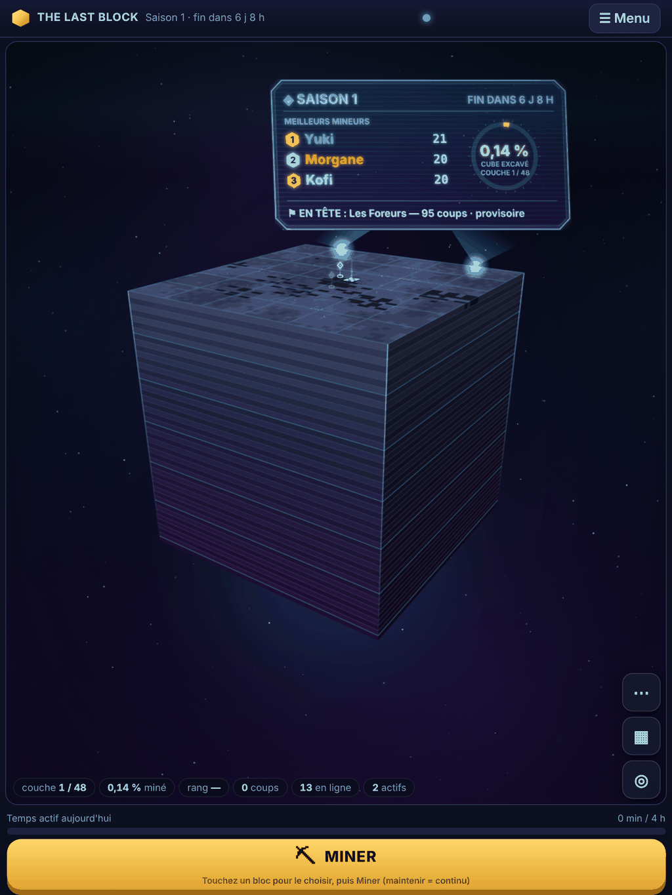
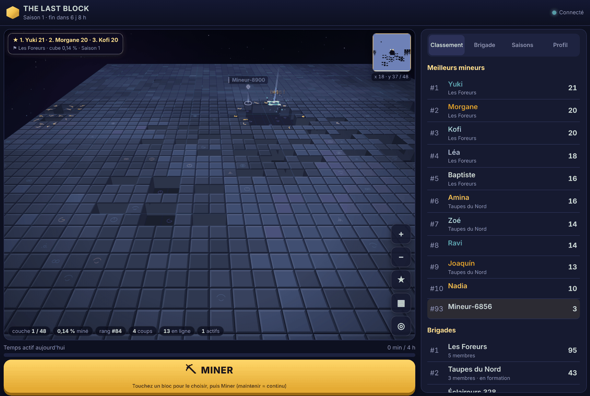
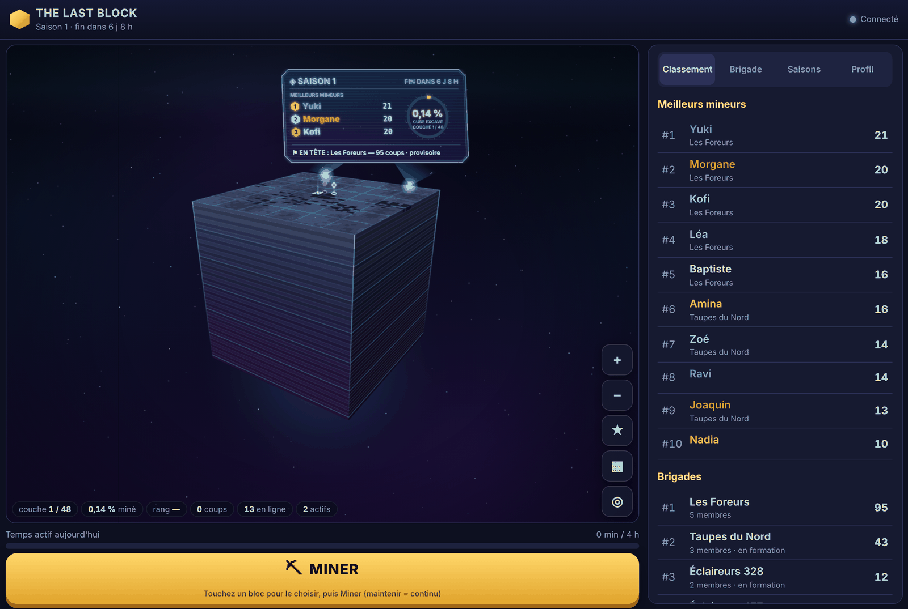

# Refonte « monolithe » — étape 2 : panneau, présence, mobile, performance

Cette étape fait suite à la validation de la direction artistique C (futuriste et mystérieuse) et de la caméra monumentale (voir [étape 1](REFONTE-MONOLITHE.md)). Elle traite les cinq conditions posées, dans l'ordre de priorité demandé : le panneau monumental et la lisibilité mobile d'abord.

## 1. Performance prioritaire

| Demande | Ce qui est fait |
|---|---|
| Le monolithe reste le rendu privilégié | Il reste le rendu par défaut. |
| Réduire effets et résolution sur appareil lent | Si moins de 30 images/s sont réellement affichées (glisser compris), ou si une image coûte plus de 14 ms en moyenne, les **effets réduits** s'activent automatiquement : densité de pixels 1, sans chanfreins, veines, glyphes ni scintillement d'ambiance. |
| Repli sur le rendu classique **pendant la session** si on reste sous 30 images/s | Fait. Si l'affichage reste sous 30 images/s pendant deux contrôles consécutifs (au moins 10 s) en effets réduits, le **rendu classique remplace le monolithe à chaud**, sans rechargement. La caméra, la sélection, la connexion et le minage en cours sont conservés. Un message prévient le joueur. Ce choix est retenu pour les visites suivantes. |
| Choix manuel toujours possible | Profil → Rendu du cube. Le changement est immédiat, sans rechargement. Un choix explicite du joueur (ou `?rendu=`) l'emporte toujours sur l'automatisme. |
| Ne pas complexifier l'architecture | Les deux rendus implémentent déjà le même contrat (`world/view.ts`). Le remplacement à chaud tient en une fonction (`swapRenderer` dans `main.ts`) et une méthode `dispose()` par rendu. |

**Deux pertes de performance découvertes et corrigées pendant les mesures :**

- **L'écran holographique hors champ était repeint à chaque image** en effets réduits : environ 13 ms par image. Il n'est désormais plus dessiné quand il est hors champ, et sa texture change de résolution par paliers.
- **En orbite autour du monument, le ciel était recomposé à chaque image** : trois dégradés plein écran, soit environ 10 ms par image avec le CPU ralenti 4 fois. Il est désormais peint une seule fois, dans un motif qui se répète, puis simplement décalé : 0,5 ms par image.

### Mesures

Mesures faites dans Chromium sans affichage, rendu **logiciel** (sans GPU), dans l'émulation iPhone 13, avec un défilement continu sur une face de 32 × 32. **Aucune mesure sur téléphone réel.** Les chiffres varient d'environ ±20 % d'une exécution à l'autre sur cette machine.

| Rendu | CPU | Minage | Monument |
|---|---|---:|---:|
| Classique | normal | 60 img/s | 60 img/s |
| Classique | ralenti × 4 | 38 img/s | 45 img/s |
| Classique | × 4 + effets réduits | 60 img/s | 60 img/s |
| Monolithe | normal | 60 img/s (dessin 2,4 ms) | 60 img/s (1,4 ms) |
| Monolithe | ralenti × 4 | 24 img/s | 35 img/s |
| Monolithe | × 4 + effets réduits | **60 img/s** (étape 1 : 24) | **47 img/s** (étape 1 : 14) |

Conséquence : sur un appareil environ 4 fois plus lent que cette machine, le monolithe en effets réduits reste au-dessus de 30 images/s. Le repli vers le rendu classique ne devrait donc intervenir que sur des appareils encore plus lents. Ce point n'a pas été vérifié sur de vrais téléphones.

**Repli automatique vérifié** (CPU ralenti 12 fois, défilement continu) :
- les effets réduits s'activent ;
- puis le rendu classique remplace le monolithe **après 17 s, sans rechargement** ;
- un coup donné ensuite est confirmé par le serveur ;
- aucune erreur JavaScript.

**Changement manuel vérifié** :
- même page, même canevas unique ;
- même sélection, même caméra ;
- le minage continue.

## 2. Panneau monumental : un écran holographique

Nouveau fichier `world/monolith/hologram.ts`. Contenu, réel et issu du serveur :

- la **saison en cours** et son compte à rebours ;
- les **trois meilleurs mineurs**, avec médailles et scores ;
- la **brigade championne provisoire** (« provisoire », ou « en formation » si elle n'a pas encore l'effectif minimal) ;
- la **progression du cube** : anneau doré, pourcentage excavé, couche courante sur le total ;
- une **alerte** le cas échéant : couche presque terminée, dernière couche, Pierre finale en jeu.

Mise en scène :
- l'écran flotte au-dessus de l'arête nord du monolithe ;
- il est projeté par deux faisceaux de lumière qui partent de l'arête ;
- il **pivote pour faire face à la caméra**, donc reste lisible quel que soit l'angle ;
- il est rendu en lumière additive sur un voile sombre (lisible devant le cube comme devant le ciel), avec un léger scintillement et des lignes de balayage (désactivés si « réduire les animations »).

**Sans masquer la surface de minage** : en vue de minage, l'écran est loin derrière l'horizon et atténué. Le bandeau compact prend le relais. En vue monumentale, l'écran est pleinement visible et le bandeau s'efface, pour éviter le doublon. ★ ou le bandeau mènent à la vue monumentale.

## 3. Présence des joueurs

- **Balises à l'échelle de la perspective** :
  - un anneau au sol, avec une onde tant que le coup est récent ;
  - un faisceau vertical ;
  - un drone en losange aux couleurs de la brigade.
  
  Les mineurs lointains sont plus petits (`scaleAt`, testé). Les alliés sont plus épais et marqués ⚑.
- **Couleurs de brigade** : une palette de dix couleurs choisies pour rester distinctes entre elles, mais aussi du doré (sélection), du rouge (refus) et du cyan (interface). L'attribution est stable, dérivée du nom, identique pour tous.
- **Aucun chevauchement des pseudos** (`world/labels.ts`, fonction pure).
  - **Placement** : glouton par priorité (alliés, puis coups récents, puis mineurs proches). Chaque étiquette essaie six positions autour de son drone et n'est affichée que si elle ne touche aucune autre étiquette.
  - **Zones évitées** : le bandeau, la mini-carte, les commandes et les indicateurs.
  - **Étiquette décalée** : un fil fin la relie à son drone.
  - **Sans place** : l'étiquette est masquée, le drone reste visible.
  - **Tests** : foule de 300 marqueurs sur 50 tirages, priorité, zones réservées, distance maximale au marqueur.
- **Uniquement des présences réelles** : rien n'a changé côté données. Seules les observations transmises par le serveur (dernier coup accepté il y a moins de 20 s) sont affichées. Aucun joueur n'est simulé. Les captures montrent de vrais robots connectés en WebSocket.

## 4. Interface mobile

- **Barre du haut sur une seule ligne** (≈ 40 px au lieu de ≈ 52 px). Le titre textuel est masqué sous 420 px de large, mais reste lu par les lecteurs d'écran ; le logo suffit à identifier le jeu.
- **Bandeau des meilleurs mineurs réduit à une ligne fine et translucide.** Le détail (brigade, progression, saison) est sur l'écran holographique, à un toucher du bandeau.
- **Mini-carte plus petite** : 64 px.
- **Commandes regroupées** :
  - ▦ (vue monumentale) et ◎ (recentrer) restent visibles, ◎ au plus près du pouce ;
  - +, −, ★ et ⚑ passent derrière « ⋯ » (le pincement remplace + et −) ;
  - toucher la surface referme le groupe ;
  - sur ordinateur, tout reste visible.
- **Bouton Miner** : inchangé, pleine largeur, en bas de l'écran.

## 5. Validation (exécutée)

- `npm test` : **133 tests** (123 auparavant), tous réussis. Nouveaux tests :
  - placement des étiquettes ;
  - alertes de l'écran ;
  - échelle locale de la caméra.
- `npm run e2e -- --rendu monolithe` : **31/31**. Une vérification nouvelle : regroupement des commandes derrière « ⋯ » sur téléphone. Les scénarios couverts :
  - gestes tactiles réels (glisser, pincer, toucher) ;
  - minage vu par un second navigateur ;
  - présence au bloc exact, brigade ;
  - panneau et vue monumentale ;
  - aucun chevauchement d'interface à 360, 390, tablette, bureau et paysage ;
  - **SIGKILL du serveur et reconnexion** avec scores conservés ;
  - `prefers-reduced-motion` ;
  - fin de saison ;
  - aucune erreur JavaScript ni violation CSP.
- `npm run e2e -- --rendu classique` : **31/31**.
- Repli automatique et changement manuel de rendu : voir § 1.
- `npm run typecheck`, `npm run build` : OK.
- Serveur, protocole, limites, anti-abus, persistance : **non modifiés**.

## Limites restantes

- Performances mesurées seulement en émulation logicielle, jamais sur un vrai téléphone.
- Les noms des robots des captures (« Mineur-1234 ») sont ceux que le serveur attribue ; de vrais pseudos sont plus courts ou plus longs, et le placement s'adapte à leur largeur.
- Un pseudo peut passer brièvement sous un effet de coup (« +1 », « bloc ») d'un autre mineur. L'effet est transitoire : il s'efface en moins d'une seconde.
- Effets de minage secondaires : non retravaillés à cette étape, conformément à la priorité demandée.

## Captures (rendu monolithe, cube de 48³, vrais robots connectés)

| | Vue de minage | Vue monumentale |
|---|---|---|
| 360 px |  |  |
| 390 px |  |  |
| Tablette |  |  |
| Bureau |  |  |

Autres captures :
- présence de douze mineurs, pseudos sans chevauchement : [mobile](captures/etape-c/presence-390.png), [bureau](captures/etape-c/presence-bureau.png) ;
- commandes « ⋯ » dépliées sur téléphone : [390 px](captures/etape-c/commandes-390.png).
