# Refonte visuelle « monolithe » — étape 1 : gigantisme et identité futuriste

Ce document couvre uniquement la première étape demandée : **la sensation d'échelle** et **le rendu futuriste et mystérieux**. Les étapes suivantes (panneau monumental redessiné, présence renforcée, effets, épuration mobile, mystère) attendent la validation de celle-ci.

## Ce qui a été modifié

| Élément | Avant | Après |
|---|---|---|
| Caméra | Vue de dessus inclinée (projection parallèle) | **Vraie perspective** (`world/monolith/persp.ts`), sans moteur 3D. Une seule caméra, deux perceptions selon le zoom. |
| Vue de minage | Grille vue d'en haut | Plongée à 35° : la surface fuit vers le lointain, se fond dans une brume bleutée (perspective atmosphérique), et laisse voir le bord du cube et le vide au-delà. |
| Vue monumentale | Fenêtre isométrique séparée | **Dans la scène** : le monolithe entier de 3/4, ses 32 à 64 strates, ses arêtes éclairées, un halo qui le fait paraître suspendu, et le panneau sur piliers de lumière. Bouton ▦ ou touche V ; un glisser fait tourner autour. |
| Transition | — | Continue, pilotée par le zoom : en pinçant vers l'arrière, on s'élève progressivement de la zone de travail jusqu'au monument. |
| Matériau | Damier beige | « Pierre-tech » : ardoise bleutée en surface, violet profond vers le cœur, en plaques à grande échelle (pas de damier). Blocs taillés en chanfrein, joints fins. Lignes de structure cyan tous les 8 blocs et veines d'énergie rares. Glyphes abstraits gravés (anneaux, arcs, points) sur ~5 % des blocs, quelques blocs « activés » à lueur ambrée. |
| Dégâts | Fissures sombres | Fissures **lumineuses** : la lumière intérieure de l'artefact affleure. |
| Puits | Creux plats | Parois éclairées selon leur orientation et sol de la couche inférieure. Des glyphes violets enfouis y apparaissent parfois, pour suggérer qu'il y a quelque chose dessous. |
| Bord du cube | Falaise en bandes beiges | Strates contrastées qui plongent dans le vide, chacune avec une arête lumineuse. |
| Ciel | Dégradé | Nuit cosmique : nébuleuses violettes et cyan, étoiles avec parallaxe en rotation, lueur d'horizon. |
| Sélection | Cadre doré | Cadre holographique cyan, équerres et faisceau vertical visible de loin. |
| Mini-carte | Beige | Aux couleurs de la pierre-tech ; masquée en vue monumentale, ainsi que le bandeau (la scène se suffit). |

## Ce qui a été conservé (inchangé)

- **Serveur** : aucune modification. Le protocole, les saisons, les classements, les brigades, les limites (4 h par jour, 5 coups/s), l'anti-abus, la persistance et la présence sont intacts.
- **Logique client** : sélection et minage (le toucher sélectionne, le bouton Miner frappe), état « en attente », aucun effet avant la confirmation du serveur, reconnexion et reprise.
- **Le rendu classique** (`world/surface.ts`) : intact et toujours disponible (Profil → Rendu du cube, ou `?rendu=classique`). Les deux rendus implémentent le même contrat (`world/view.ts`), ce qui permet de changer de rendu sans toucher au reste.
- **Le panneau, la présence et les effets** : **repris tels quels**, sans refonte. Le panneau existant est peint dans une texture et posé dans la scène 3D ; les marqueurs de présence et les effets sont simplement projetés en perspective. Leur refonte fait l'objet des étapes suivantes.

## Rendu par défaut et filet de sécurité

Le rendu « monolithe » est désormais **le rendu par défaut**, car il est jouable et testé (voir plus bas). Pour les appareils modestes :

1. Si la fluidité réelle tombe sous ~25 images/s, **glisser du doigt compris**, les effets réduits s'activent automatiquement : résolution standard, sans chanfreins, veines ni glyphes.
2. Si elle reste sous ~20 images/s, le **rendu classique** sera utilisé au prochain chargement, avec un message au joueur. Il n'y a pas de rechargement en pleine partie.
3. Un choix explicite du joueur (Profil) ou de l'URL l'emporte toujours.

Vérifié dans Chromium avec un CPU ralenti 12 fois : les effets réduits s'activent, puis le rendu classique est utilisé au rechargement. Sans ralentissement, aucun déclenchement intempestif (image toutes les 17 ms).

## Défauts trouvés et corrigés pendant l'étape

- **Glisser imprécis en perspective** : la formule linéaire faisait « glisser » le point saisi de 9 px pour 72 px de geste. Elle est remplacée par la formule exacte ; un test le vérifie.
- **Rendu inutilisable sur une face de 64 × 64** (4 images/s) : remplir un seul chemin de milliers de polygones coûte ~32 ms dans Chromium, contre ~1,2 ms par paquets de 24 (mesuré). D'où :
  - des lots de 32 polygones ;
  - un ciel mis en cache ;
  - un vignettage en CSS ;
  - la fusion des blocs lointains en bandes ;
  - les blocs de moins de 2,5 px non dessinés ;
  - la texture du panneau repeinte seulement si son contenu change.

  Résultat sur 64 × 64 : 4 → 42 images/s à CPU normal.
- **Mesure de fluidité aveugle aux glisser** : les deux rendus ne mesuraient la fluidité que pendant l'inertie et les animations, jamais pendant que le doigt glisse. C'est corrigé, et les images d'ambiance au repos sont exclues.
- **Détection inopérante sur appareil très lent** : il fallait 60 images de moins de 250 ms. Elle juge désormais sur 20 images, sans plafond trompeur.
- **Notification sur la mini-carte** (360 et 390 px, rendu monolithe) : l'emplacement des notifications est maintenant recalculé à chaque affichage.

## Impact sur les performances (mesuré)

Mesures faites dans Chromium sans affichage, rendu **logiciel** (sans GPU), dans l'émulation iPhone 13 avec un défilement continu. **Aucune mesure sur téléphone réel.** Sur un vrai téléphone, le GPU accélère la pixellisation ; seul le coût JavaScript (colonne « dessin ») reste comparable.

Face de 32 × 32 (taille par défaut) :

| Rendu | CPU | Minage | Monument |
|---|---|---:|---:|
| Classique | normal | 60 img/s | 61 img/s |
| Monolithe | normal | 45 img/s (dessin 12 ms) | 43 img/s (14 ms) |
| Classique | ralenti × 4 | 15 img/s | 18 img/s |
| Monolithe | ralenti × 4 | 10 img/s | 10 img/s |
| Classique | × 4 + effets réduits | 42 img/s | 39 img/s |
| Monolithe | × 4 + effets réduits | 24 img/s | 14 img/s |

Face de 64 × 64 à CPU normal : monolithe 42 à 44 images/s (contre 4 avant les optimisations).

**Compromis assumé** : le rendu monolithe coûte environ **2 à 3 fois plus** que le rendu classique. Sur un appareil modeste, il fonctionne en effets réduits (~24 images/s en minage) ; plus lent encore, le filet de sécurité bascule vers le rendu classique. La taille du client passe de 65 à 96 Ko de JavaScript (de 23 à 32 Ko compressé), sans aucune dépendance ajoutée.

## Tests réellement exécutés

- `npm test` : **123 tests**, dont 10 nouveaux pour la caméra en perspective :
  - centre et échelle ;
  - aller-retour écran ⇄ surface ;
  - rétrécissement avec la distance ;
  - transition monotone ;
  - cube entier à l'écran en vue monumentale, pour 4 tailles et 4 formats ;
  - glisser exact et zoom ancré ;
  - rotation en vue monumentale ;
  - horizon ;
  - inertie et limites.
- `npm run e2e -- --rendu monolithe` : **30/30**, deux fois de suite (mêmes scénarios que le rendu classique) :
  - deux navigateurs, gestes tactiles réels ;
  - minage après déplacement, vu par l'autre navigateur ;
  - présence, brigade ;
  - vue monumentale aller et retour ;
  - aucun chevauchement à 5 tailles d'écran ;
  - SIGKILL du serveur et reprise ;
  - `prefers-reduced-motion` ;
  - fin de saison ;
  - aucune erreur JavaScript ni violation CSP.
- `npm run e2e -- --rendu classique` : **30/30** (aucune régression).
- `npm run typecheck`, `npm run build` : OK.

Deux vérifications ont été adaptées à la perspective, car elles supposaient une vue de dessus :
- « bloc hors de la vue initiale » devient « bloc éloigné du point de départ », la perspective montrant déjà une grande partie de la face ;
- le contrôle du panneau mesure sa largeur à l'écran.

## Limites restantes (à traiter dans les étapes suivantes, après validation)

- **Panneau** : c'est encore l'ancien panneau, simplement posé dans la scène. Il est petit et peu lisible sur mobile. « Regarder le panneau » mène pour l'instant à la vue monumentale. → étape C.
- **Présence** : les marqueurs gardent une taille fixe quelle que soit la distance, et les noms des mineurs lointains se chevauchent. → étape D.
- **Effets** : repris de l'existant, adaptés à la nouvelle palette mais pas redessinés. → étape E.
- **Mobile** : le bandeau masque le haut de la vue de minage, là où se trouvent le bord du cube et le panneau au loin, et les commandes de caméra restent nombreuses. → étape F.
- **Mystère** : les glyphes, les blocs activés et les glyphes enfouis restent volontairement rares et décoratifs ; ils ne correspondent à aucune donnée de jeu.
- **Performance** : nettement plus coûteux que le rendu classique. Pistes : face supérieure en texture en vue monumentale, ou WebGL si nécessaire, mais avec prudence.
- **Une seule face jouable** : inchangé, c'est une contrainte du modèle serveur.

## Captures

Les captures « avant » montrent le rendu classique ; les captures « après » le rendu monolithe, sur un cube de 48³ avec des zones réellement minées et de vrais robots connectés (aucun joueur simulé).

| | Avant (classique) | Après — vue de minage | Après — vue monumentale |
|---|---|---|---|
| 360 px | 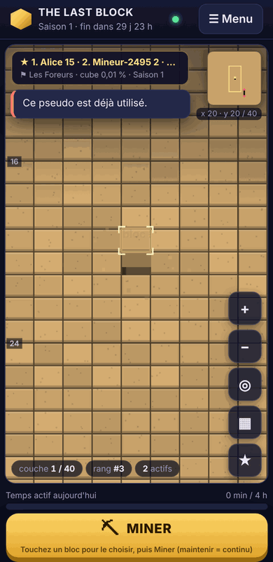 | 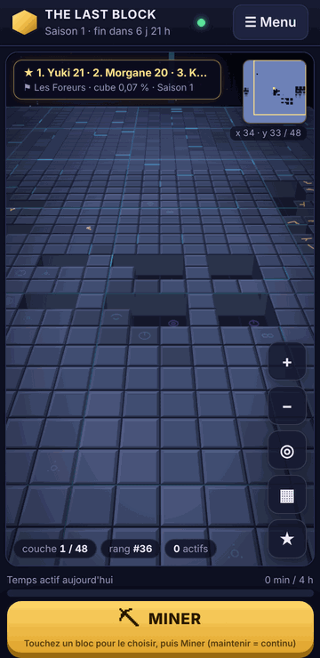 | 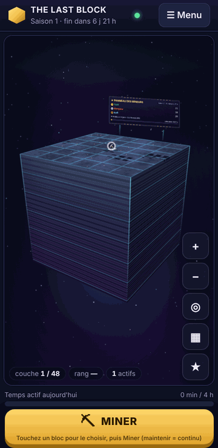 |
| 390 px | 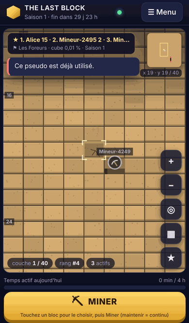 | 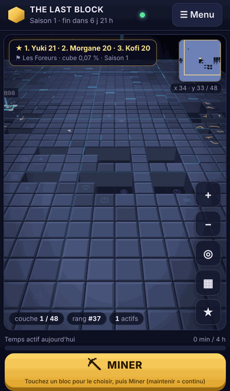 | 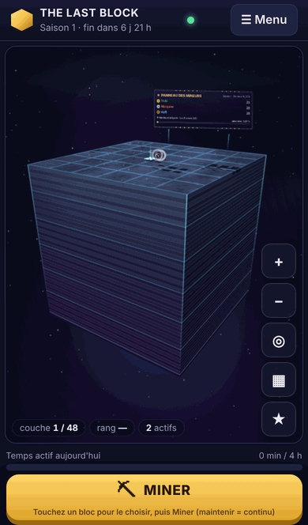 |
| Tablette | 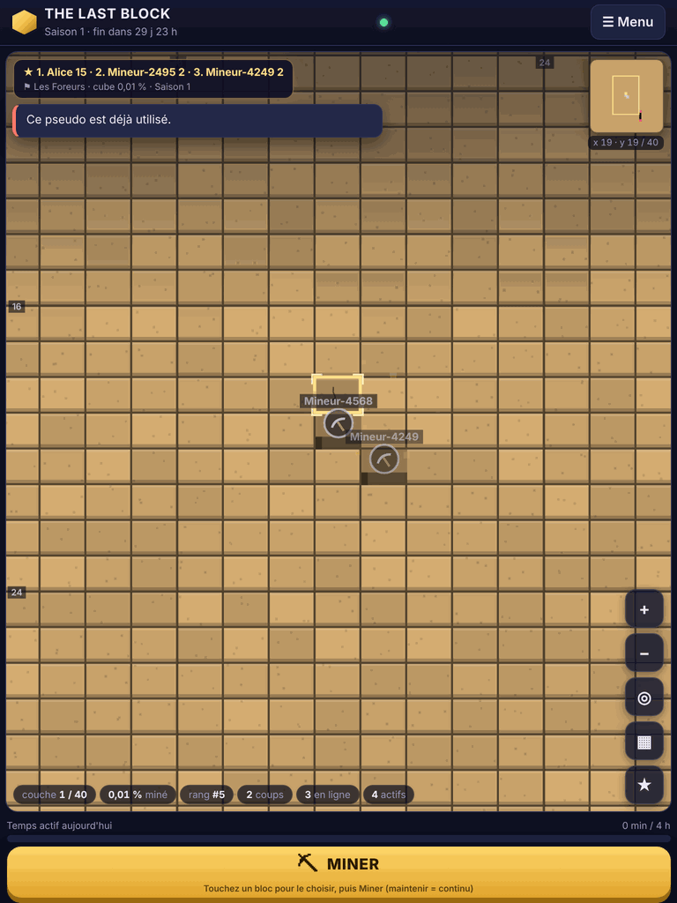 | 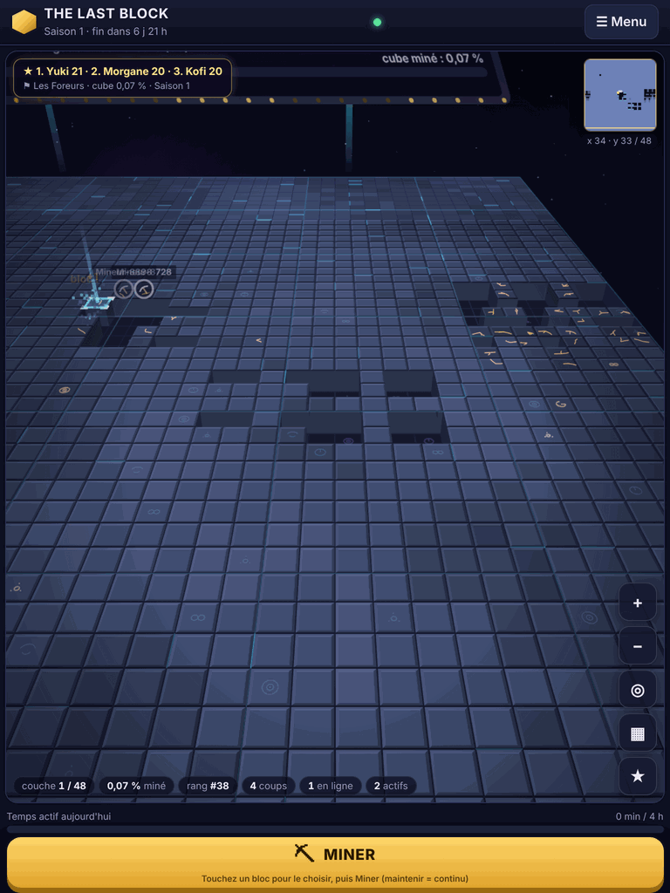 | 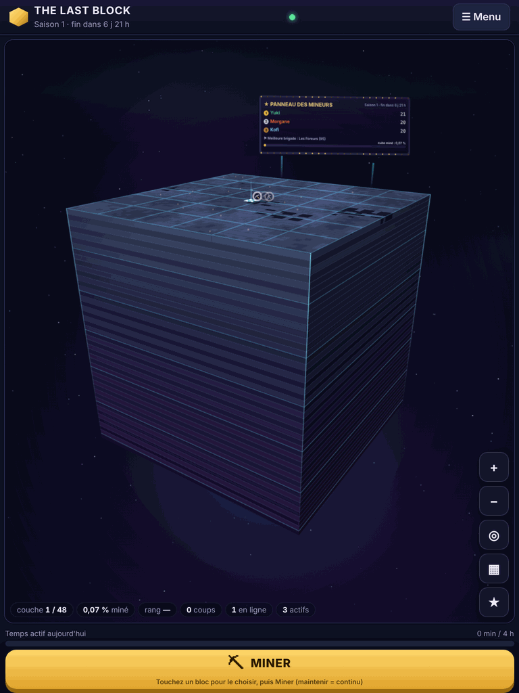 |
| Bureau | 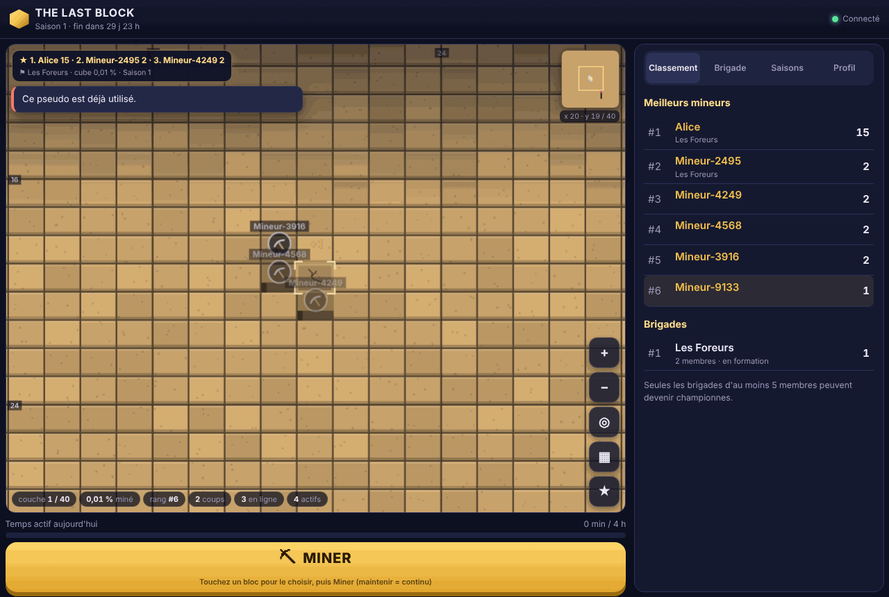 | 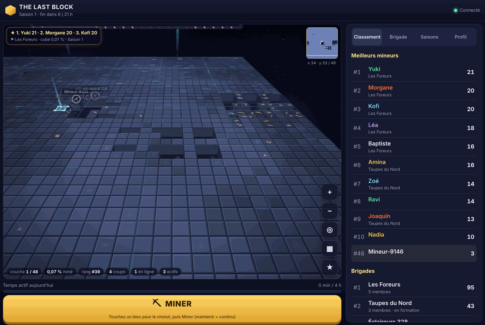 | 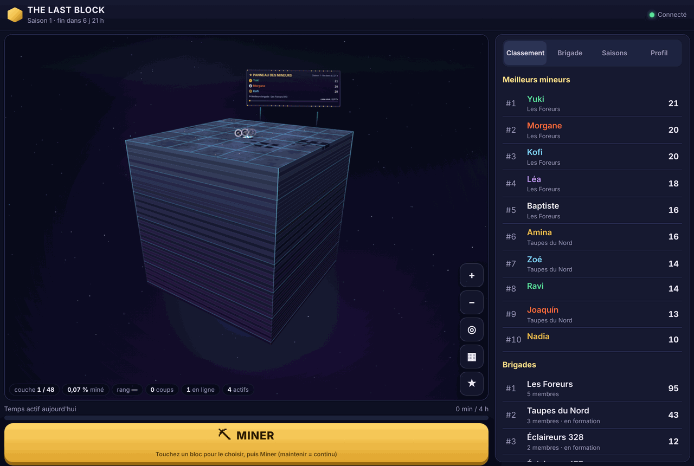 |

Bord sud (falaise des strates) : [mobile](captures/monolithe/bord-sud-390.png), [bureau](captures/monolithe/bord-sud-bureau.png).
