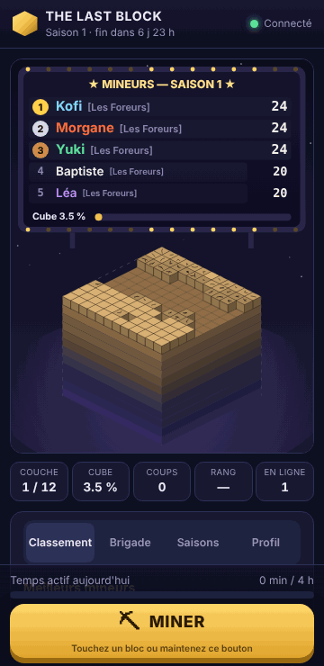
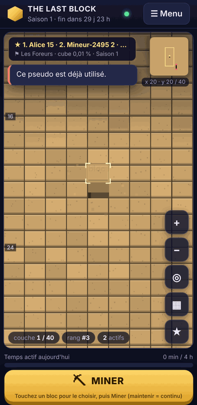
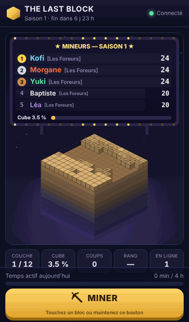
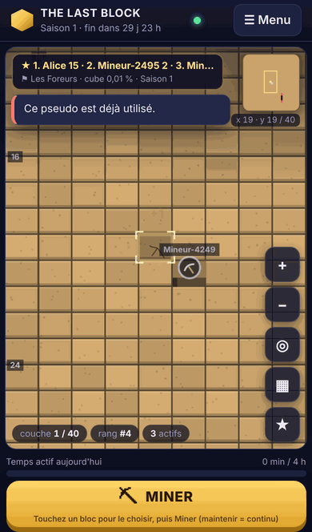
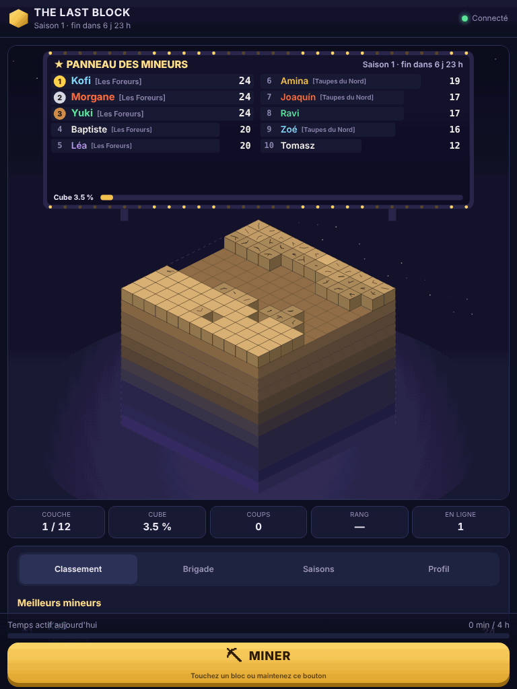
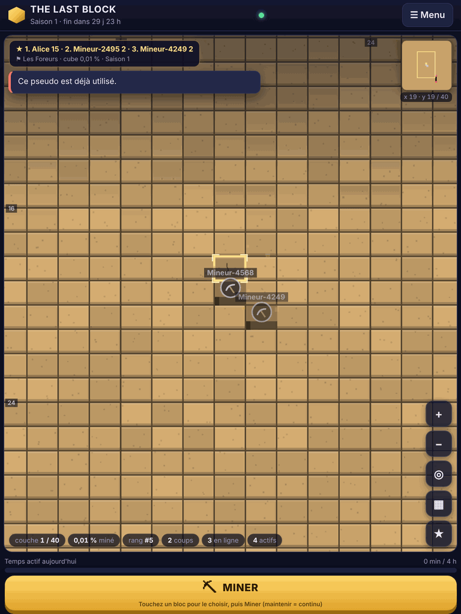
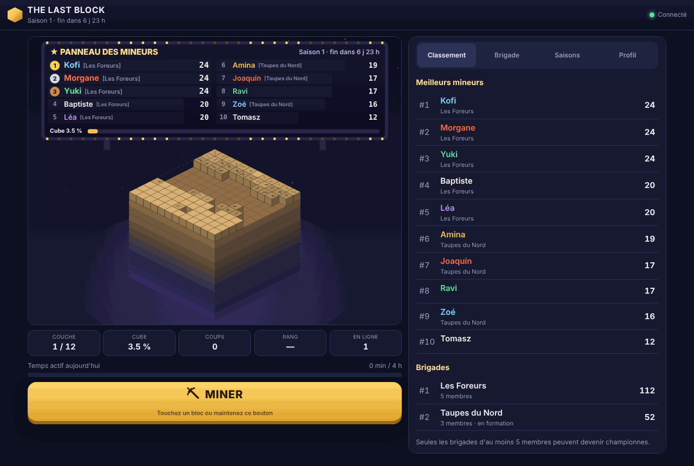
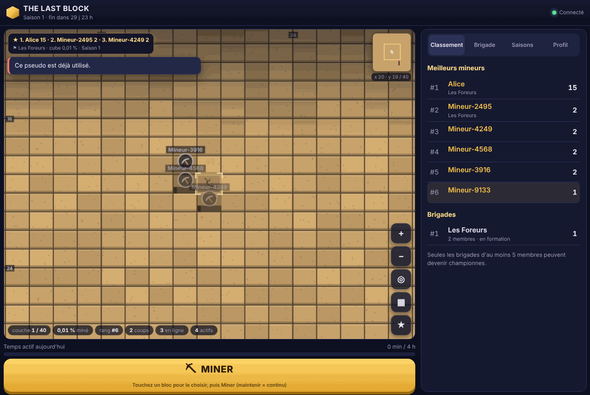

# Refonte visuelle : cube colossal navigable

Ce document trace la refonte de l'interface (novembre 2026) : analyse de départ, architecture retenue, ce qui est réellement fonctionnel et ce qui ne l'est pas.

## Phase A — Analyse du prototype existant

### Ce qui existait

- `client/src/scene.ts` : un seul canvas dessinant **tout le cube** en isométrique (taille fixe, petite) et un panneau top 10 au-dessus.
- Le serveur n'expose que la **couche courante** : une grille `taille × taille` (`CubeSnapshot.currentHp`, index `y × taille + x`) mise à jour par deltas absolus `[couche, bloc, pv]`. Seule cette couche est minable.
- Un toucher sur le canvas **sélectionnait et minait** immédiatement.
- `main.ts` déclenchait un effet d'impact **dès l'envoi** du coup, avant la réponse du serveur (le serveur restait autoritaire sur les PV, mais l'impact visuel était anticipé).
- Taille de cube par défaut : 10 (100 blocs par couche), maximum 64.

### Risques identifiés

| Risque | Décision |
|---|---|
| Le modèle serveur n'a pas de « faces » : les couches sont des tranches horizontales. | Une seule face jouable : **le dessus de la couche courante** (`faceId: 'top'`). Aucune autre face n'est présentée comme jouable. |
| Une surface « monumentale » exige plus de blocs que 10 × 10. | Taille par défaut portée à **32** (1 024 blocs par couche) ; le maximum de 64 (4 096 blocs, ~2 800 px de large à 44 px par bloc) suffit sans modifier le protocole. Les règles (PV, saisons, limites) ne changent pas. |
| Coût du dessin d'une grande grille. | Culling : seuls les blocs visibles sont dessinés ; rendu à la demande (pas de boucle permanente quand rien ne bouge). |
| Conflit entre glisser (déplacer la caméra) et toucher (sélectionner), et avec le défilement de la page. | Seuil de mouvement par type de pointeur ; `touch-action: none` sur la surface ; sur mobile, la page ne défile plus : les panneaux deviennent un tiroir. |
| Toucher = miner : un glissement mal reconnu minerait par erreur. | Toucher = **sélection seule** ; le bouton Miner (ou Espace) agit sur le bloc sélectionné. |
| Effets anticipés. | Supprimés : l'envoi affiche un état « en attente » ; impact, fragments et destruction ne sont montrés qu'après confirmation du serveur (réponse ou delta). |
| Changement de couche : toute la surface est remplacée. | Caméra conservée, sélection déplacée sur le bloc vivant le plus proche. |
| Présence des autres joueurs : aucune donnée côté serveur. | Phase D : présence **dérivée des coups réels** (dernier bloc miné il y a moins de 20 s), agrégée et diffusée au plus une fois par seconde. Aucun mouvement de caméra n'est transmis. |
| Tests navigateur existants fondés sur « toucher = miner ». | Script e2e réécrit : glisser, pincer, sélectionner après déplacement, miner. |

### Architecture retenue (client uniquement, sans dépendance)

```
client/src/world/
  face.ts       modèle d'une face : index ⇄ (x, y), voisinage, bloc vivant le plus proche, plage visible
  camera.ts     caméra 2.5D : centre (x, y) en blocs, zoom (px/bloc), inclinaison, inertie, limites, animations
  gestures.ts   reconnaissance tap / glisser / pincer (logique pure, testable) + liaison DOM, molette, clavier
  surface.ts    rendu Canvas 2D de la face visible (blocs en relief, puits, falaise, repères d'échelle, effets)
  minimap.ts    mini-carte de toute la face, rectangle de vue, saut par toucher
client/src/scene.ts   l'ancienne vue isométrique, réutilisée pour la « Vue d'ensemble »
```

Les modules `face`, `camera` et la logique de `gestures` n'accèdent pas au DOM : ils sont testés par Vitest.

## Phase B — Surface navigable (fonctionnelle)

- **Une seule face jouable** : le dessus de la couche courante (`faceId: 'top'`). La taille par défaut est passée à 32 × 32 blocs, et la configuration accepte jusqu'à 64 × 64. Les autres faces ne sont **pas** présentées comme jouables.
- **Caméra** (`world/camera.ts`) : point visé en blocs, zoom de 5–24 à 96 px par bloc (borné), légère inclinaison (`TILT = 0.78`) qui rend visible la face avant des blocs, inertie avec frottement, limites (un bord de face ne dépasse pas le milieu de l'écran), zoom ancré sous le doigt ou le curseur, animations.
- **Gestes** (`world/gestures.ts`) : un toucher bref (≤ 10 px au doigt, 5 px à la souris, ≤ 500 ms) **sélectionne**, un glisser déplace la caméra avec lancer, deux doigts pincent pour zoomer, la molette zoome. Un pincement ne produit jamais de sélection.
- **Clavier** : flèches, ZQSD ou WASD pour se déplacer, + et − pour zoomer, C pour recentrer, V pour la vue d'ensemble, P pour le panneau, B pour la brigade, Espace ou Entrée pour miner, Échap pour fermer.
- **Minage** : le toucher sélectionne seulement ; le bouton Miner (maintien = continu, 4,5 coups/s au plus côté client) ou Espace frappe le bloc sélectionné. Si ce bloc a disparu, la cible devient le bloc vivant le plus proche. La caméra suit la cible si elle sort de l'écran. Le toucher est « aimanté » vers un bloc vivant proche (≥ 22 px) ; un puits n'est jamais sélectionnable.
- **Rendu** (`world/surface.ts`) : culling sur la plage de blocs visibles, tracés regroupés par teinte (environ 20 remplissages par image), rendu uniquement quand quelque chose change. La surface comprend des blocs en relief avec biseau, texture et fissures selon les dégâts, des puits avec le sol de la couche inférieure, le mur nord et l'ombre portée, la falaise sud qui montre les strates restantes, un repère tous les 8 blocs avec graduations, et de la brume au loin.
- **Outils** : mini-carte (toucher ou glisser pour s'y rendre, rectangle de vue, sélection), coordonnées, boutons Zoomer, Dézoomer, Recentrer et Vue d'ensemble (l'ancienne vue isométrique du cube entier ; toucher un bloc pour s'y rendre).
- **Mise en page** : sur mobile la page ne défile plus ; la surface occupe l'espace entre la barre du haut et la barre d'action ; les panneaux s'ouvrent en tiroir. Sur un téléphone en paysage, la barre d'action est compacte. La position de caméra est mémorisée par profil et par saison.

## Phase C — Sensations de minage

| État | Déclencheur | Rendu |
|---|---|---|
| En attente | coup envoyé, pas encore de réponse | contour en pointillés animé ; au-delà de 400 ms, le bouton Miner signale l'attente réseau |
| Impact confirmé | `mineResult` accepté | flash, éclats, « +1 » |
| Bloc détruit | `mineResult` accepté avec `destroyed` | gerbe d'éclats, anneau de poussière, légère secousse, « bloc ! », vibration |
| Coup refusé | `mineResult` refusé | flash rouge et tremblement du bloc, message explicite |
| Coup d'un autre joueur | delta du serveur | flash et éclats discrets |

Aucun de ces effets n'est déclenché à l'envoi : le serveur reste seul juge.

- **Effets réduits** (réglage du profil) : résolution standard, peu de particules, pas de secousse.
- **Activation automatique** : les effets réduits s'activent d'eux-mêmes si une image prend plus de ~14 ms à dessiner, ou si l'affichage réel tombe sous ~25 images/s pendant les animations.
- **`prefers-reduced-motion`** : pas d'inertie, pas de secousse, animations de caméra instantanées, ampoules fixes.

## Phase D — Panneau monumental et présence réelle

- **Panneau du décor** (`world/billboard.ts`) : planté au-delà du bord nord, sur piliers, avec ampoules et lueur projetée sur la face. Il affiche le top 3, la meilleure brigade, l'avancement, la saison et le compte à rebours. Un bandeau compact en haut de la surface résume ces informations ; le toucher (ou ★, ou P) amène la caméra devant le panneau, et le bandeau se masque alors. Le classement complet reste dans l'onglet Classement.
- **Présence** : modification de protocole nécessaire, puisque le serveur n'envoyait aucune information de position.
  - La présence est dérivée des **coups acceptés** : le dernier bloc frappé par chaque joueur au cours des 20 dernières secondes, conservé en mémoire seulement.
  - Elle est diffusée avec le classement, au plus une fois par seconde, avec 40 entrées au maximum.
  - **Aucune position de caméra n'est transmise.**
  - Une option « montrer ma position » est persistée en base (colonne `presence_hidden`).
  - Côté client, chaque marqueur montre une pioche animée tant que l'observation date de moins de 2,5 s, un anneau aux couleurs de la brigade (gris sans brigade), le nom et un fondu selon l'âge. Il y a aussi un compteur « actifs » et des points sur la mini-carte.
  - Sans observation, rien n'est affiché. « Rejoindre ma brigade » (⚑ ou B) amène la caméra vers le membre vu le plus récemment, ou annonce qu'aucune position n'est connue.

## Phase E — Tests réellement exécutés

- `npm test` : **113 tests** sur 10 fichiers, dont 18 pour la caméra, les gestes et la face (`tests/world.test.ts`) et 5 pour la présence (`tests/presence.test.ts`).
- `npm run e2e` : **30 vérifications sur 30**, exécuté plusieurs fois de suite avec le même résultat.
  - Le test utilise deux Chromium distincts : un iPhone 13 émulé avec gestes tactiles réels via le protocole CDP, et un ordinateur 1280 × 860.
  - **Premier coup confirmé ~0,3 s** après l'ouverture, sans aucun réglage.
  - Glisser horizontal et vertical, pincer avant et arrière dans les bornes, zoom qui conserve la sélection.
  - Sélection, après déplacement, d'un bloc absent de la vue initiale, puis minage : le coup est vu par l'autre navigateur.
  - Côté bureau : glisser, molette, flèches, clic, Espace. La destruction est identique des deux côtés et la sélection passe au bloc voisin.
  - Maintien du bouton : 12 coups en 2,5 s.
  - Brigade créée via le tiroir mobile et rejointe par code. La présence est vue **au bloc exact frappé** avec la brigade, et « Rejoindre ma brigade » fonctionne.
  - Panneau, Recentrer, Vue d'ensemble.
  - **Aucun chevauchement** à 360, 390, tablette 768 × 1024, bureau 1280 × 860 et paysage 740 × 360, une notification réelle étant affichée pendant le contrôle.
  - **SIGKILL du serveur** puis reconnexion automatique : mêmes comptes, scores, brigade, et la caméra n'a pas bougé.
  - `prefers-reduced-motion` : aucune inertie.
  - Fin de saison et nouvelle saison avec une surface intacte et un bloc présélectionné.
  - Aucune erreur JavaScript ni violation CSP.

## Phase F — Performances mesurées

Mesures faites dans Chromium sans affichage, dans un conteneur Linux à 4 vCPU, avec rendu **logiciel**, dans l'émulation iPhone 13. **Aucune mesure sur téléphone réel.**

| Face | Zoom (px/bloc) | CPU | Images/s pendant un défilement | Dessin moyen / p95 |
|---|---|---|---:|---|
| 64 × 64 | 6 (face entière) | normal | 61 | 0,8 / 1,1 ms |
| 64 × 64 | 42 | normal | 61 | 0,5 / 0,8 ms |
| 64 × 64 | 6 | ralenti × 4 | 19 | 5,5 / 18,1 ms |
| 64 × 64 | 42 | ralenti × 4 | 20 | 2,8 / 6,2 ms |
| 64 × 64 | 6 | × 4, effets réduits | 37 | 3,8 / 6,5 ms |
| 64 × 64 | 42 | × 4, effets réduits | 43 | 2,3 / 4,0 ms |
| 64 × 64 | 96 | × 4, effets réduits | 57 | 1,3 / 2,3 ms |

- **Où passe le temps** : avec le CPU ralenti, le dessin lui-même reste court. La perte de fluidité vient de l'affichage d'un canevas haute densité, avec un rendu logiciel sans GPU. C'est pourquoi les effets réduits (résolution standard) s'activent maintenant automatiquement quand moins de ~25 images/s sont affichées ; ce basculement a été vérifié sur ce scénario.
- **Mémoire** : tas JavaScript d'environ 10 Mo.
- **Taille du client** : 65 Ko de JavaScript (23 Ko compressé) et 11 Ko de CSS, sans dépendance ajoutée.

## Ce qui n'est pas fait

- Une seule face jouable. Les cinq autres faces du cube n'existent pas dans le modèle serveur (couches horizontales), et le type `FaceId` ne contient que `'top'`.
- Pas de vraie perspective : l'effet 2.5D repose sur l'inclinaison et la face avant des blocs. Pas de moteur 3D, comme demandé.
- La présence ne montre que le **dernier coup** (moins de 20 s) : on ne voit pas un joueur qui se déplace sans miner, et c'est voulu.
- Pas de test sur téléphones physiques, Safari ou Firefox ; les gestes tactiles sont émulés par CDP dans Chromium.
- Pas de navigation au clavier bloc par bloc (le clavier déplace la caméra ; Espace mine la sélection ou le bloc le plus proche du centre).
- Sur un téléphone en paysage, la surface reste petite (environ 160 px de haut sur 360 px), utilisable mais peu confortable.

## Captures

| | Avant | Après |
|---|---|---|
| 360 px |  |  |
| 390 px |  |  |
| Tablette |  |  |
| Bureau |  |  |

Autres captures : [panneau monumental](captures/mobile-panneau.png), [présence et brigade (bureau)](captures/bureau-presence.png), [vue d'ensemble](captures/mobile-vue-ensemble.png), [hors ligne pendant le SIGKILL](captures/mobile-hors-ligne.png), [paysage](captures/apres-paysage.png). Ces captures proviennent du test réel : les mineurs visibles sont les comptes créés par le test, pas des joueurs simulés.
